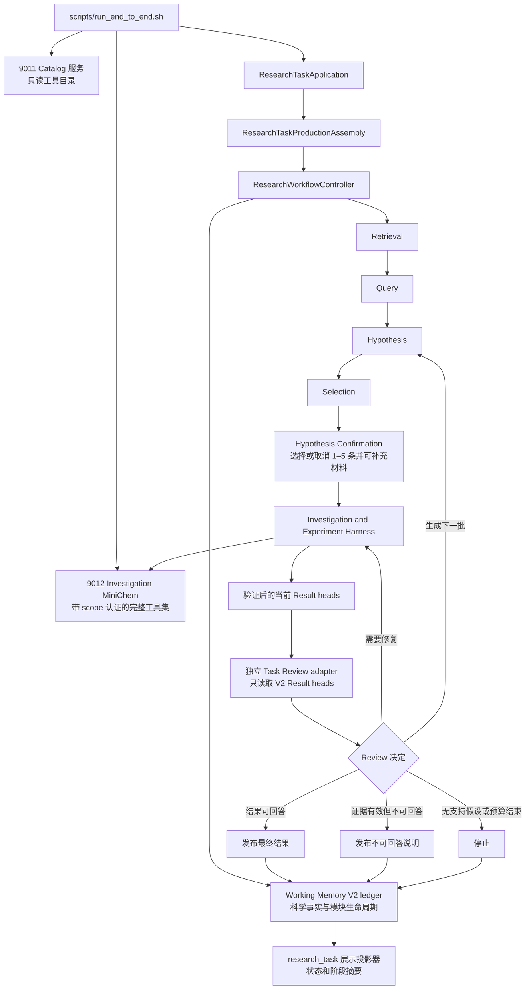

# ARCHE Harness 当前架构与安全修改指南

本文件面向刚接手 ARCHE Harness 的维护者和代码 Agent，说明当前生产调用链、模块职责、
持久化 owner、恢复身份、MiniChem 和模型边界，以及修改后必须执行的回归检查。先用本文建立
当前架构地图，再从公开入口和对应测试核对精确行为。

本文件适用于 `harness` 分支中的生产源码、测试、启动脚本和可提交配置。`local_data/legacy/author_src_old/` 仅供静态阅读旧命名，不是当前实现或运行入口。`third_party/minichem_toolbox/` 的内部实现由上游维护；ARCHE 只通过本文件说明的 MCP 边界使用 MiniChem。

## 接手与修改要求

维护者或代码 Agent 必须按以下顺序工作：

1. 在分析问题前，确认任务属于当前 `investigation_v2`、Top 5、启动脚本、schema-v10 V2
   只读迁移，还是已停止支持的 `legacy_workflow_v1`。
2. 从公开入口沿实际调用顺序读取源码，不根据目录名、旧类名或环境变量推断当前流程。
3. 在修改源码前，检查第 9 节的架构规则，并根据第 10.3 节定位必须同时核对的合同和测试。
4. 修改持久化状态、恢复身份或阶段顺序时，同时检查领域合同、Working Memory 事件、当前索引重建、任务级返回和 `research_task` 展示摘要。
5. 完成修改后，运行与影响范围匹配的测试，更新 `docs/current/CASE1_HARNESS_E2E_TASK_LOG_2026-08-21.md`，并使用明确路径提交可推送文件。

如果任务要求违反第 9 节规则，或者只有大范围重构才能实现，代码 Agent 不得绕过现有合同。代码 Agent 必须先向研究人员说明冲突位置、影响范围和已有测试证据，再等待决定。

本文件描述当前架构边界，源码和测试定义精确的可执行行为。三者出现差异时，代码 Agent 不得静默选择其中一种说法。代码 Agent 应从当前公开入口核对实际调用，判断是文档过时还是实现缺陷；经过确认的架构变更必须在同一任务中更新源码、测试、本文件和任务日志。

## 1. 先确认当前流程，不要从旧模块名称推断

仓库当前只运行 `investigation_v2`。历史 `legacy_workflow_v1` 资料可能仍在 Git 历史或本地
运行目录中，但不再是生产任务、公开恢复入口或自动迁移目标。

| 架构版本 | 用途 | 新任务是否使用 | 主流程 | 等待状态 |
|---|---|---:|---|---|
| `investigation_v2` | 当前 Investigation and Experiment 流程 | 是 | `retrieval` → `research-query-formulation` → `hypothesis-generation` → `hypothesis-selection` → `hypothesis-confirmation` → `hypothesis-investigation` → `task-review` → 发布结果或生成下一批假设 | `awaiting_researcher_confirmation` 或 `waiting_investigation_job` |
| `legacy_workflow_v1` | 历史资料，仅供人工审阅 | 否 | 不提供当前运行或自动恢复流程 | 不适用 |

新建 Memory On 任务固定写入 `stage_architecture_version=investigation_v2`。恢复任务时，Controller 必须读取原 `ResearchTaskCreated` 事件中的架构版本；缺失或明确为 `legacy_workflow_v1` 时直接 fail-closed，不能根据当前环境变量或当前默认配置猜测，也不会初始化旧 Planner/Executor。相关入口位于：

> 当前生产入口已经固定为 V2 Module Controller。默认 Harness adapter 使用
> V2-native Context/Session/Harness；schema-v10 旧事实只由显式只读 reader 和迁移
> 入口读取。这只是受控的 V2 存储格式迁移，不是对 `legacy_workflow_v1` 的支持。
> `HarnessRecoveryStore` 负责当前 Harness 的私有恢复事实，不能把旧架构状态解释成 V2 任务。

- [`ResearchTaskApplication.create_standard_research_task`](src/chemistry_multiagent/controllers/chemistry_multiagent_controller.py)：普通完整任务入口。
- [`ResearchTaskApplication.create_author_hypothesis_task`](src/chemistry_multiagent/controllers/chemistry_multiagent_controller.py)：从原始科学问题和一至五条作者假设开始的新任务入口。
- [`ResearchTaskApplication.create_top5_confirmation_task`](src/chemistry_multiagent/controllers/chemistry_multiagent_controller.py)：运行 `retrieval`、`research-query-formulation`、`hypothesis-generation` 和 `hypothesis-selection` 后停在确认边界的 Top 5 入口。
- [`ResearchTaskApplication.get_hypothesis_confirmation`](src/chemistry_multiagent/controllers/chemistry_multiagent_controller.py) 与 [`ResearchTaskApplication.submit_hypothesis_confirmation_and_continue`](src/chemistry_multiagent/controllers/chemistry_multiagent_controller.py)：读取研究员视图，以及提交完整决定、可选指导语和文件流。
- [`ResearchTaskApplication.resume_research_task`](src/chemistry_multiagent/controllers/chemistry_multiagent_controller.py)：对外恢复入口；读取已保存的架构版本，仅 V2 进入恢复，旧架构直接拒绝。

旧 Planner、Execution、Reflection agent 及闭环控制器已经从当前生产源码删除。历史任务若声明
`legacy_workflow_v1`，公开恢复入口抛出 `UnsupportedArchitecture`；不创建新状态、不调用旧模块，
也不把历史字段迁移成 V2 事实。

## 2. 运行时总体结构



图中有三个不能混淆的边界：

1. V2 Working Memory 保存跨模块科学事实和公开模块生命周期；`HarnessRecoveryStore` 保存 Harness 私有执行恢复引用。`research_task` 任务目录是供研究员查看的状态与阶段摘要，不能作为恢复事实来源。源码中的 `RunBundle` 只是管理该目录的实现类名，不引入 `run_id` 或另一层运行聚合。
2. `9011` 只提供 Catalog，也就是工具、合同和版本信息；它不能提交、查询或收集计算。实际 MiniChem Action 由带 session scope 的 `9012` 提供。
3. Confirmation 只写研究员决定和执行输入，不调用 9011、9012 或科学模型；每个 Investigation session 可以调用 `9012`，Task Review 只能读取 Evidence 接口提供的当前结果版本，不能提交或推进化学计算。

## 3. 当前端到端流程

### 3.1 Shell 入口

标准入口是 [`scripts/run_end_to_end.sh`](scripts/run_end_to_end.sh)。它负责：

1. 检查仓库标准 `.venv`、私有配置文件是否存在以及运行目录是否合法。
2. 固定并核对 `9011` Catalog 和 `9012` Investigation 端点。
3. 验证 Catalog 身份、工具集合和临时 scope 认证。
4. 区分新任务与显式恢复任务；脚本不会自动恢复旧任务。
5. 调用 `chemistry_multiagent_controller` CLI。

通用入口保留在 `scripts/` 根目录。特定 Case、冻结输入或本机实验使用的 wrapper 统一放在
[`scripts/tasks/`](scripts/tasks/)；这些 wrapper 不是新的生产公开入口，也不能替代
`run_end_to_end.sh` 的任务创建与恢复合同。仓库当前不提供集群提交 wrapper。

服务启动脚本分别是：

- [`start_catalog_bootstrap_mcp.sh`](scripts/services/start_catalog_bootstrap_mcp.sh)：固定 `catalog_bootstrap` profile 和 9011。
- [`start_investigation_minichem.sh`](scripts/services/start_investigation_minichem.sh)：固定 9012、scope registry、scheduler 和 `--scope-auth`。
- [`start_minichem.sh`](scripts/services/start_minichem.sh)：公共 MiniChem 启动和固定资源检查。

启动脚本必须先通过真实 MCP readiness，再启动 Controller。只检查端口监听不足以证明服务身份、Catalog 版本和 scope 认证正确。

公开运行配置使用以下名称：`ARCHE_RUN_STORAGE_ROOT` 指向私有运行根（`research_task` 任务目录
随后写入其下的 `outputs/research_tasks/`），`ARCHE_STAGE_HARNESS_WORKSPACE_ROOT`
和 `ARCHE_STAGE_HARNESS_TRACE_ROOT` 分别指向前置模型阶段的 workspace 与 trace，
`MINICHEM_INVESTIGATION_ENDPOINT` 指向 9012，`MINICHEM_SERVICE_WORKSPACE` 指向
MiniChem 服务工作区，`MINICHEM_SCOPE_REGISTRY_ROOT` 指向 scope registry。旧环境变量
只允许在第三方服务启动 adapter 边界做显式映射；ARCHE 生产代码、脚本和公开帮助不把
旧名称作为配置入口。

### 3.2 CLI 分派

`run_from_args` 只接受六个 research_task action：`create-standard-research-task`、
`create-author-hypothesis-task`、`create-top5-confirmation-task`、
`get-hypothesis-confirmation`、`submit-hypothesis-confirmation-and-continue` 和
`resume-research-task`。确认提交 action 是同一应用确认 seam 的薄适配器：本地路径只在
CLI 中打开为二进制流，不进入 Working Memory。该入口不会把旧 schema-v10 控制器
当作外层恢复状态机，也不会创建 Planner、`WorkflowExecutor` 或旧流程控制器。Memory Off
在当前入口直接拒绝，不能静默转入旧流程。

标准入口按 `retrieval` → `research-query-formulation` → `hypothesis-generation` → `hypothesis-selection` → `hypothesis-confirmation` → `hypothesis-investigation` → `task-review` 执行，Selection 必须原子保存恰好五条候选。作者 `entry_strategy=author_hypothesis_import` 执行 `hypothesis-import` → `hypothesis-confirmation` → `hypothesis-investigation` → `task-review`：确定性导入一至五条已经审查的作者假设，不调用 `retrieval`、`research-query-formulation`、`hypothesis-generation` 或 `hypothesis-selection`。两条路径都在确认模块保持 `Open`，由研究员明确执行或取消全部候选，最终执行一至五条。标准 Top 5 入口停在该确认边界。历史 `investigation_v2.task.v1` 仍按原冻结顺序只读恢复。

### 3.3 创建任务与固定运行事实

[`ResearchTaskProductionAssembly.create_research_task`](src/chemistry_multiagent/controllers/investigation_v2_production.py) 在科学阶段开始前完成 V2 任务装配。核心步骤是：

1. 创建 `research_task` 任务目录和 V2 Working Memory ledger。
2. 将科学问题、预算、`entry_strategy`、模型配置、作者导入身份和研究材料大小/数量策略写入唯一 `ResearchTaskCreated` 事实。
3. 从 `ResearchTaskFacts` 构造 `ResearchWorkflowController`；默认 factory 连接 Retrieval、Query、Hypothesis Generation、Hypothesis Import、Selection、研究员 Confirmation、V2-native Investigation Context/Harness 和 V2 Task Review adapter。
4. 在每个公开模块边界提交 Module Invocation start、Scientific Records 和完成事实，并从同一 ledger 恢复；底层历史事件名 `ModuleRunStarted` 仅为重放兼容。

当前默认生产装配已经使用 V2-native `InvestigationContextBackend`、独立子 Harness 和
`V2TaskReviewRuntime`：科学事实只写 V2 ledger，Harness 私有恢复事实只写对应的
`HarnessRecoveryStore`，Review 只读当前 Result heads。旧 schema-v10 的任务控制器、
旧任务控制器、composition bridge 和 WM coordinator 已从生产源码删除；schema-v10
只读 reader 和迁移测试只转换历史事实。外层 V2 Controller 不读取旧 thread、turn、job、scope、submission、
receipt 或 sidecar，也不使用这些字段决定下一模块。

`ResearchTaskCreated` 至少固定科学问题、化学上下文、任务配置、输出相对目录和工具目录 SHA-256；还可以固定模型配置、专家后端、Case profile、Gaussian 路由、架构版本和作者假设导入信息。任务行与 `ResearchTaskCreated` 事件在同一 SQLite 事务内写入。

`ResearchTaskCreated` 必须早于 Retrieval。后续恢复应复用这些值；不能因为环境变量改变而更换模型、Catalog、架构、Case profile 或输出位置。

候选生成和研究员待确认阶段只读取任务中冻结的本地配置与安装包提供的静态能力描述，
不调用 9011/9012，也不执行 endpoint 可用性准入检查。首次 Investigation 在
Context Store 已保存 Session 身份后，必须先通过 native Session resolver 的准备接缝
读取或冻结任务级完整 Catalog，再创建 MiniChem scope、workspace 或模型运行；恢复已有
冻结包时只做本地完整性复验。

#### Case 3 旧内部实验入口的结构文件

该入口是统一确认接口形成前的内部实验兼容路径，不是新研究任务提供文件的标准接口。统一的新作者假设入口只冻结原始科学问题和结构化作者假设；Case 3 的四个结构、二面角原子映射及其他补充文件都应在 Hypothesis Confirmation 中作为普通 `materials` 提供。旧内部入口仍保留其既有严格五文件校验，以便读取或审查已经按该合同创建的任务，但这些字段不能进入 task.v2 的通用 base prompt。

旧 Case 3 主假设探索输入包含四个仅保留固定结构标题、`0 1` 和原子坐标的结构文件，以及一个记录四组 Br–N–N–H 原子序号的 JSON 文件。作者原始 GJF、计算日志、Gaussian 方法、基组、溶剂模型、资源设置、扫描范围和步长都不进入这组文件。Harness 只从命令行指定的准备目录读取这五个文件；目录必须是绝对路径、不能是符号链接，并且不能包含其他文件。结构文件按标题、行数、元素组成和坐标行白名单校验，原子序号文件使用拒绝重复键和非有限数字的严格 JSON 解析，不能只依靠计算关键词黑名单。

历史内部任务创建时，Harness 校验文件名、正文和 SHA-256，将正文与摘要写入 `ResearchTaskCreated.input.hypothesis_import.structure_input`，同时在任务目录的 `inputs/case3/` 保存任务副本。每个 Investigation Session 创建自己的 workspace 后，Harness 再把同一内容复制到该 workspace 的 `inputs/case3/`。模型提示只给出这五个相对路径，不提供外部准备目录或任务目录路径。

读取这类历史任务时以 `ResearchTaskCreated` 中冻结的正文和摘要为准，不重新读取外部准备目录；任务副本缺失时可以由冻结正文重建，摘要漂移时停止。`case3_fixed_reproduction` 在这里仅用于兼容 Case profile 和冻结语料，Gaussian 路由仍由同一冻结 MiniChem Catalog 决定，不会固定方法或扫描参数。此前的 `author_case3_main_hypothesis_only` 仅为读取已保存任务保留，不再提供创建新任务的 CLI 开关。

### 3.4 Retrieval

普通完整任务先执行 Retrieval。科学上下文提取只接收原始科学问题，输出必须满足严格结构；协议错误不能猜测默认结果。V2 adapter 成功后写入 `RetrievalRecord`，恢复时复用已保存的 Retrieval 和 Query 模块输出，不重复调用对应模型。

当前论文回放的 `--no-search` 只有在冻结论文库满足以下条件时才合法：

- manifest 已完成；
- 实际文献数达到目标；
- PDF 数量与 manifest 一致；
- PDF 唯一性和 SHA 集合一致；
- corpus fingerprint 合法。

`--no-search` 不运行在线 PaperSearch，但仍可使用本地 BGE embedding 建立或读取索引。Retrieval 未完成时，任务保持 `paused`/`retrieval_incomplete`，不能写成普通科学失败。

作者假设直入模式不运行 Retrieval、Query、Hypothesis Generation 或 Selection，而是通过独立 Hypothesis Import 模块把一至五条已经审查的作者假设直接保存为逐假设记录。该模式和标准 Top 5 的数量规则不同，不能伪造排名选择，也不能复用普通模式的“生成下一批”行为。

### 3.5 Hypothesis

Hypothesis 阶段包含生成、关系判断、允许的合并和稳定排序：

1. 多个生成请求可以并行，但最终顺序按输入顺序确定；发生多个错误时，最小输入索引的错误先返回。
2. 关系只允许规定的 `merge`、`complement`、`conflict`、`independent` 等类型。
3. 只有 `merge` 可以执行 synthesis；其他关系只记录判断，不能生成新的科学证据。
4. 所有关系判断完成后才能排序；同分结果按原输入顺序保持稳定。
5. 公开的假设科学内容保留 `source Query` 来源，但不向后续模型暴露内部 ID、排名和分数。

普通批次固定选择五个假设。后续生成下一批时，必须通过 [`regeneration_bridge.py`](src/chemistry_multiagent/investigation/regeneration_bridge.py)，复用已经保存的 Retrieval、Query、科学历史和生成操作身份；不能直接调用 Hypothesis Agent 绕过 Working Memory。

### 3.6 Hypothesis Confirmation

新 `investigation_v2.task.v2` 在每个 Selection 或 Hypothesis Import 后创建唯一的
Open `hypothesis-confirmation` Module Invocation。读取入口从 Working Memory 重建稳定视图，
只返回任务身份、并发序号、源批次引用以及候选引用、排名和原始假设；普通恢复在研究员
尚未提交时返回完全相同的视图，不装配 Catalog、Session、scope、模型或化学作业。

确认写入口接收 `confirmation_id`、`expected_research_task_sequence`、覆盖全部候选的决定，以及
可选 `files` 文件流。每条 execute 决定包含最终假设快照、可选 `guidance` 和有序
`materials` 引用；cancel 决定不能携带这些字段，并且全部候选至少执行一条、最多五条。
确认服务先按 `ResearchTaskCreated` 冻结策略把实际引用的文件流写入任务级内容寻址存储，再以一个
`PreparedModuleInvocationOutput` 原子提交一条 `HypothesisExecutionDecisionRecord`、一至五条
`HypothesisExecutionInputRecord` 和去重后的 `ResearchMaterialRecord`。Working Memory
只保存安全文件名、媒体类型、大小、摘要、描述和不透明内容引用，不保存外部路径或正文。
材料摄取可能跨越较长时间，因此 Controller 在材料发布完成、Working Memory 提交开始前
再次核对 lease；失锁时保留 Open Confirmation，材料 CAS 可由新 holder 的精确重试复用。

同一确认身份、相同结构化字段和相同文件摘要可以精确重放；正文或文件摘要漂移返回幂等
冲突，过期的并发序号不能覆盖 Open 确认。确认完成后，Controller 只把执行输入记录交给
Investigation，取消项不能创建 Context Session。每个 Session 的副作用顺序固定为：保存
Session 和 Invocation 身份、创建 workspace、从任务级存储核对并物化该 Session 声明的
材料、准备 Catalog/scope、启动 provider。材料缺失保持 Open 并返回
`RecoveryEvidenceMissing`；摘要或目标漂移返回 `VerifiedIntegrityConflict`，两者都发生在
模型或 MiniChem 作业之前。

模型的 base system prompt 不含 Case 名称、工具强制选择或确认内部身份。user payload 只含
原始科学问题、该 Session 的最终假设、可选 `guidance` 和材料在该 workspace 中的安全相对
路径。取消项、排名、外部路径、`content_ref` 和其他 Session 材料均不能进入 prompt。

### 3.7 Investigation 批次

V2 `ResearchWorkflowController` 只在模块边界推进流程。默认 Investigation adapter
调用 `InvestigationContextBackend`；新 `investigation_v2.task.v2` 只从当前 Confirmation
形成的 `HypothesisExecutionInputRecord` 规划一个 Context 和一至五个独立 Session，历史
`task.v1` 才从 `SelectedHypothesisRecord` 恢复原输入。每个 Session 再打开自己的 Harness 与
`V2NativeInvestigationBackend`，在形成完整 Result heads 后返回 `PreparedModuleInvocationOutput`。
它不会同时调用 Task Review。随后，V2 Controller 把这些结果交给独立的
`V2TaskReviewRuntime`，Review 只读取 V2 Result heads，并把 ReviewRecord、
RepairRequestRecord 或 FinalAnswerRecord 写回 V2 ledger。Review 要求生成下一批时回到
Hypothesis；作者主假设导入模式不允许生成下一批。

`InvestigationContextBackend` 的恢复依据是 Context Store 和各子 Harness 的
`HarnessRecoveryStore`，不是任务目录展示文件或 Working Memory 的私有运行字段。
恢复时已有子 Session 走同一 Harness invocation 的 `resume`，尚未轮到的 Session 才走
首次 `start`；返修是新的 Module Invocation，但从同一 Session owner 的
`CodexSessionStore` 找回原 thread。历史 schema-v10 资料只能由只读 reader 解析，再由
`InvestigationV2Migration` 写入新的 research_task ledger；被删除的 composition bridge
和 WM coordinator 不再提供运行或恢复入口。

V2-native Review 的公开纵向切片位于 [`investigation/review_runtime.py`](src/chemistry_multiagent/investigation/review_runtime.py)。
`V2TaskReviewRuntime` 只通过 V2 Working Memory 的 `ResearchTaskFacts`、当前
`InvestigationResultRecord` heads、每个 Result 明确引用的
`VerifiedEvidenceRecord` 以及冻结 Task input/policy 构造 request；它在 provider
调用前重算并核对每个 record 的 payload digest、task/source 引用和 Evidence snapshot
的 pair/source artifact manifest。`V2TaskReviewModuleAdapter` 是给 V2
`ModuleRunner` 的一行装配 seam：成功时形成同一 Module Invocation 的
`ReviewRecord`，并按公开 outcome 原子形成 `FinalAnswerRecord` 或
`RepairRequestRecord`。该模块不构造 schema-v10 `InvestigationState` 或
`BatchCreated`，不把 thread、turn、job、scope 或 sidecar 当作科学事实，也不调用
MiniChem；provider/Evidence 暂不可用保持 typed `Suspended`，已核实的身份或摘要
冲突才是 `VerifiedIntegrityConflict`。

生产路径的科学状态只写 Working Memory。`InvestigationSQLiteStore` 仅用于 Hypothesis 生成回执和明确启用的测试替代实现，不能成为生产 V2 的第二套科学状态。

`InvestigationContextBackend` 可以按冻结并发限制推进一至五个 Session；每个 Session 必须保持独立的：

- `hypothesis_execution_input_record_id` 和 `investigation_session_id`；
- Codex thread 与 turn；
- MiniChem scope 和 workspace；
- operation、job 和结果版本；
- repair 历史。

“每次只能有一个尚未 collect 的作业”指每个 Session，而不是整个 research_task。不同
Session 可以并行拥有各自的活动作业。

Investigation 的 MiniChem gateway 只允许 `verify_execution_references`、
`read_scientific_artifact_text`、`get_execution_resources` 和 `get_execution_job` 四个只读工具。
scope session 在 readiness 后可能长时间闲置并被服务端断开；下一次只读调用遇到传输不可用或命令超时
时，gateway 会隔离旧连接、保留同一 scope binding（包括原 research_task、Context、Session、执行输入和 capability 身份），
建立一次 fresh session 并只重试同一只读请求。重试最多一次；非只读工具根本不能进入该接口，协议、
scope/身份核对错误和 fresh session 的第二次失败都直接 fail-closed。这个恢复不创建新 scope、不改变
thread 或 evidence 身份，也不提交、查询或收集化学作业。真实 Streamable HTTP client 使用 30 秒普通
请求超时和 300 秒持续响应流读取超时；不能沿用 HTTPX 的 5 秒默认读取超时，否则引用较多的合法核验
会在 gateway 的 300 秒调用边界之前被客户端主动断开。

#### 3.6.1 Investigation Codex Goal

新的 Investigation 默认使用普通 Codex turn，不启用 Goal。模型正常结束当前 turn 但没有形成合法 Result、
等待作业、人工停止或预算终态时，Harness 在同一 thread 创建新的 continuation turn；provider/transport
中断时先恢复原物理 turn。连续两次 completed turn 没有产生任何新协议事实时返回可恢复的
`model_no_progress`，不能把一个正常结束但无 Result 的 turn 当作整个 Investigation 已完成。

Goal 只作为显式实验和已冻结 Goal session 的兼容恢复能力。底层状态由
`thread/goal/set`、`thread/goal/get`、`thread/goal/clear` 和 Goal 通知提供；仓库内的 Python SDK 封装负责把同一
Goal 的多个物理 turn 聚合为一个逻辑调用，并提供只读恢复入口。Review 不进入 Goal 路径。

首次调用在联系 provider 前保存 Goal 创建意图（intent），其中包含所属 session、thread、请求摘要、目标摘要和调用前的
物理 turn 数量。每次收到物理 turn 或 Goal 状态通知都按顺序追加物理 turn 记录（journal）；只有保存了最终 Goal
完成收据（receipt），运行时才把结果交给 Working Memory。三类文件都位于当前 `CodexSessionStore` 的完成收据目录，
只能由同一 session 读取和确认，不能使用另一 session 的路径。确认完成收据前必须核对 Goal 身份、请求摘要、完整物理
turn 范围、最终 Goal 状态和最后物理 turn 状态；核对完成后才按“物理 turn 记录→创建意图→完成收据”顺序清理。

恢复必须先为原 thread 接管 Goal 通知，再读取 `thread/goal/get` 和完整 thread history，并按保存的 checkpoint
（恢复核对信息）核对 Goal、物理 turn 连续顺序和调用前基线。恢复只读取原 Goal，不发送 `clear` 或 `set`。只有
provider 明确返回不存在 Goal、本地创建意图尚未绑定 provider Goal、物理 turn 记录为空且 history 仍等于调用前基线
时，才允许重试首次创建；其它缺失、乱序、身份冲突或状态不确定都进入 `goal_recovery_required`。

只有 Goal 为 `complete`、最后物理 turn 为 `completed` 且最终响应存在时，才能形成 Investigation 成功结果。
`paused`、`blocked`、`usage_limited` 和 `budget_limited` 只保存为可恢复状态；如果同一 session 仍有已提交的
MiniChem 作业，外层继续使用 `waiting_investigation_job` 和原作业身份，不能用 Goal 状态覆盖或重新提交作业。
已有 Goal 恢复记录的 session 继续走原 Goal 路径，不在恢复中途改成普通 turn。
Goal 开关属于 thread 的冻结能力策略。运行时恢复 Investigation session 时，默认先按普通 turn 计算策略摘要；
只有 manifest 中的摘要与显式 Goal 候选完整一致，才继续启用 Goal，并把同一选择传给 SDK 配置和分流。其它字段
发生变化时两个摘要都不会匹配，仍由显式 provider 迁移
门禁停止，不能把 provider 或认证变化误判为旧普通 session 的兼容恢复。

模型可见的首次调查、repair、唤醒和 continuation 提示统一要求：Gaussian 或其他化学计算提交后约 1、5、10、20、
30 分钟查询，之后每约 30 分钟持续查询。该节奏是模型调用约束，不是本地计时器；作业身份、终态判定和重复提交防护
仍由上述持久化记录与 MiniChem 回执决定。

SDK 事件流空闲检测也是有限边界，不是 Investigation 总时限。Investigation 的普通模型事件流默认允许 1800 秒无新事件，
Task Review 仍为 300 秒；调用方显式设置的正数继续优先。submit 回执只有同时给出唯一作业身份和明确非终态时，才切换到
21600 秒的外部作业等待检测；明确终态或 collect 后立即恢复普通模型事件流边界。因此长时间化学作业不会被 300 秒误杀，
而计算结束后的模型静默仍会在有限时间内停止并进入可恢复状态。

### 3.8 异步 MiniChem 作业

模型提交 MiniChem 作业后，native Harness 将 `job_id`、operation、`submission_key`、请求摘要和
provider receipt 引用写入当前 Session 的 `HarnessRecoveryStore`。只有经过 MCP 合同解析的真实工具回执
可以形成作业身份；模型正文中的 ID 不可信。MiniChem runtime 仍是物理作业状态和计算产物的权威来源，
`HarnessRecoveryStore` 只保存稳定引用、摘要和恢复生命周期。

`waiting_investigation_job` 表示作业已经提交，但当前 Module Invocation 尚未形成可提交的
`InvestigationResultRecord`。恢复必须遵守：

1. 从原 `research_task_id`、Module Invocation、Context 和 Session 打开同一 Harness invocation。
2. 复用同一 thread、scope、`job_id`、operation、submission 和请求摘要。
3. 先查询原作业；达到终态后按同一身份收集，不能重新 submit。
4. provider receipt、Harness recovery 事件、Evidence 验证和 Working Memory Result 必须各由自己的 owner 写入，不能互相补造。
5. continuation 如需顺序提交下一项作业，必须形成新的 Harness operation 与作业身份，并保存其直接来源。
6. 身份缺失、冲突或远端状态不明确时保持 Open 或返回明确完整性失败，不能用猜测结果继续。

同一个 provider turn 可以依次收集旧作业并提交下一项作业。每次持久边界都必须先保存能够恢复当前
Harness invocation 的稳定引用，再把结果交给上层；进程退出后，新的 facade 从同一 recovery store
判断是重放 completed receipt、恢复原 invocation，还是等待尚未轮到的首次 start。科学 Result 只有在
Evidence 核验完成后，才由外层 Controller 以 `PreparedModuleInvocationOutput` 原子写入 Working Memory。

schema-v10 的 `waiting_investigation_jobs.json`、resumable turn 索引和 wake sidecar 仅由第 6.3.2 节的
显式只读迁移接缝检查，不是 native 任务的恢复 owner。`waiting_execution` 只属于历史
`legacy_workflow_v1`，当前入口不读取、查询或收集它。

### 3.9 结果验证、repair 和 Task Review

Investigation 结果先通过 Evidence gateway 验证，再写入当前 session 的结果版本。核心领域对象位于 [`investigation/domain.py`](src/chemistry_multiagent/investigation/domain.py)：

- `InvestigationSession`：session 阶段、repair 次数和路由标记。
- `InvestigationResult`：当前科学结果和 `supported/refuted` 自判断。
- `ValidationFinding`：程序与证据验证的 pass/fail 结果。
- `BatchValidation`：当前批次完整结果版本集合和可回答判断。
- `InvestigationState`：合法路由及其身份一致性检查。

Task Review 只能在当前批次全部预期 session 都具有完整结果版本后运行。V2-native
Review runtime 复用任务内同一个 Review thread，只通过 V2 Working Memory 的公开
`ResearchTaskFacts` 和 Scientific Record 读取当前 Result heads、Evidence 引用及冻结 Task
input/policy；它不能读取 schema-v10 Working MemoryService、旧 projection、原始日志、
路径、MiniChem job 身份或 scope，也不能提交化学计算。当前 Result heads 必须精确
覆盖 Review 输入；90 个核心作业和 11 个历史终态概念不在 Review runtime 重新做
相等性推断。底层 Review 与 Evidence 合同统一接受一至五条当前结果。新 task.v2 的
精确数量来自最新闭合 Confirmation 中 Decision 声明的执行输入，且每条 Result 必须
唯一引用其中一条执行输入并完整覆盖该集合；Review 不根据 `entry_strategy` 或当前结果数
猜测入口模式，也不能只审查定向返修后的子集。重新生成假设并再次确认后，旧批次 Result
继续作为不可变事实保留在科学图中，但不进入新一轮 Review。历史 task.v1 没有 Decision 时继续按
冻结入口策略核对旧数量，不能由当前规则重解释。

Review 的 Evidence 快照默认最多绑定 64 个已登记文本产物，以容纳同一结果中由多组计算和后处理形成的完整证据链；第 65 个及之后的产物仍拒绝创建快照。提高数量上限不改变单个产物大小、单次读取字符数、累计读取字符数、摘要重验、来源身份和访问权限限制。

Review 可以产生以下路由：

| 路由 | 含义 | 后续动作 |
|---|---|---|
| `accept` | 当前证据足以给出答案 | 先满足 marker 检查，再写任务终态和最终答案 |
| `answerability_explanation` | 当前证据有效，但不能回答原问题 | 写不可回答说明并结束 |
| `repair_required` | 某个 session 结果或证据不合格 | 在原 session、原科学上下文内修复 |
| `regenerate_hypotheses` | 当前批次不能支持答案，且仍有批次预算 | 记录完整 marker 后生成下一批 |
| `failed` | 已确认的 Investigation 执行、基础设施或合同失败 | 保存失败原因，保留已有 Result/Review/Evidence，不写成功终态或 marker |
| `waiting_investigation_job` | 已提交作业尚未形成 Result | 保存身份并在恢复时继续原作业 |
| `investigation` | 仍需继续当前 session | 继续当前批次 |

repair 的规则是：

- 必须修复原 session，不能新建替代 session；
- 每条执行输入的返修次数由 `ResearchTaskCreated.input.task_config.max_investigation_repairs_per_combination` 冻结为正整数；早期未保存该字段的 V2 任务按 3 次解释；
- repair 请求本身不消耗次数，只有成功写入新 Result 才增加计数；
- 有 pending repair 时不能提前结束任务或写假设修订 marker；
- 接受混合批次前，必须先给被证伪的 session 写完整 marker。
- 任一当前 Result 的返修前驱深度达到冻结预算后，下一次 DS 调用必须在同一 Review thread 使用
  `task_finalization`，根据当前 Result heads 和同一 Evidence 快照输出最终 findings、可回答性和终局文本；
  该请求不能再产生 `RepairRequestRecord`，也不能因预算耗尽进入错误退出。Controller 按终局响应正常闭合任务。
- 维护者如需纠正已接受的 `succeeded` 终态，必须显式绑定当前 TaskClosed、Review、Result、组合和
  repair advice，追加不可变更正事件；旧事件不删除或改写。当前视图随后恢复为同一 session/thread
  的 pending repair，普通恢复入口继续该 repair，新的 Result 使用新的 Review 版本和 TaskClosed。每次 TaskClosed
  的 operation identity 必须包含本次 `review_event_ref`：相同 Review 的精确重试复用同一 operation，更正后的新
  Review 使用新 operation，不能占用或改写旧 TaskClosed 事实。终态清理
  已撤销原 scope capability 时，只能由该更正事件为相同 research_task、Context、Session、执行输入、scope 和 workspace
  追加一代新 capability；旧撤销记录必须保留。普通 repair、事件类型或正文身份漂移均不得获得新授权。

marker 是“该 session 已完成当前批次路由处理”的持久化标记。它用于阻止部分 session 尚未处理时提前接受、结束或生成下一批。

### 3.10 发布任务结果

V2 的任务终态先写 Working Memory，再同步 `research_task` 任务目录：

- `succeeded`：有可回答的最终结果；
- `stopped_no_supported_hypothesis`：没有支持假设或批次预算耗尽；
- 不可回答说明：证据有效但不能形成答案，保存说明后结束；
- `failed`：基础设施或合同失败，必须先写唯一失败事实。

`research_task` 任务目录的阶段摘要不能反向创建或修改科学事实。普通摘要写入失败不应改变 Working Memory；终态同步失败必须在下一次恢复中以 Working Memory 的终态或失败事实重新核对。

## 4. 模块职责

代码 Agent 应按职责定位修改范围，不要只按文件名搜索。

| 职责区域 | 主要目录 | 职责 |
|---|---|---|
| 应用控制 | `src/.../controllers/` | CLI、任务入口、V2 恢复分流、阶段级控制；旧架构只作显式拒绝 |
| 调查与实验 | `src/.../investigation/` | session、turn、异步作业、Evidence、scope、Review 和领域规则 |
| Working Memory 与持久化 | `src/.../memory/` | 合同、不可变事件、当前索引、SQLite 事务和恢复快照 |
| Agent 与模型服务 | `src/.../agents/`、部分 `utils/` | Retrieval、Hypothesis、当前模型路由与专家启动检测 |
| 工具集成 | `src/.../tools/` | MiniChem Adapter、Catalog 固定和资源策略 |
| 运行时合同与任务目录 | `src/.../harness/`、`src/.../utils/` | Codex 运行、Prompt 输入视图、`RunBundle` 目录实现、模型调用审计、通用合同 |
| MiniChem MCP 服务 | `third_party/minichem_toolbox/src/minichem_mcp_tools/` | 9011/9012 profile、scope 认证、工具注册、作业监督、查询、收集和结果传输 |
| MiniChem 执行核心 | `third_party/minichem_toolbox/src/minichem_toolbox/` | 协议无关的 Action/Backend 合同、Catalog、资源校验、Backend handler 和 worker |
| MiniChem 内部依赖与数据 | `third_party/minichem_toolbox/vendor/`、工具箱内的 `vendor/` 与 `data/` | Backend 使用的第三方源码和科学数据，不是 ARCHE 或模型的工具入口 |
| 测试与回归数据 | `tests/` | 单元、协议、恢复、入口和端到端替代实现测试 |
| 项目运行与运维 | `scripts/`、CI 配置 | 本地/集群入口、MCP 启动、readiness、环境检查 |
| 项目文档 | `README.md`、`docs/` | 当前交付、历史设计和复现说明 |
| 配置与案例数据 | 配置模板、`supplementary/` | 可提交的非秘密配置和固定案例输入 |

### 4.1 `controllers/`

这一层决定“运行哪套架构、当前执行哪个阶段、何时返回”。

- `chemistry_multiagent_controller.py`：公共入口、CLI、输出根和 V2 恢复架构分流；收到 `legacy_workflow_v1` 时 fail-closed，不再初始化旧模块。
- `investigation_v2_production.py`：V2 生产装配、`ResearchTaskCreated` 创建、确认读取/提交、同一 ledger 的 resume 和任务目录投影；它按冻结策略重建任务级材料 store。
- `investigation_v2_confirmation.py`：唯一研究员确认写入口；拥有候选视图、完整决定校验、文件摄取、幂等比较和 Decision/Input/Material 原子输出，不调用模型或 MiniChem。
- `investigation_v2_adapters.py`：默认 Retrieval、Query、Hypothesis Generation、Hypothesis Import 和 Selection adapter；Investigation/Review 的 native 装配在 `investigation_v2_native_adapters.py`。
- `investigation_v2_native_adapters.py`：把 V2 Scientific Records 接到 `InvestigationContextBackend`、每个假设的独立 Harness Session 和 `V2TaskReviewRuntime`；构造阶段不启动模型、MCP 或化学作业。
- `investigation_v2_module_controller.py`：V2 的模块循环 seam；只读取
  `ResearchTaskFacts`，在模块边界按 Retrieval → Query → Hypothesis → Top 5 Selection →
  Hypothesis Confirmation → Investigation and Experiment → Review 的确定性顺序编排。它只把
  `ModuleInvocationRequest` 交给公开模块 adapter，不读取 Harness 的 thread、turn、Goal、
  scope、job、submission 或 receipt。当前生产入口由它承载；标准入口按完整顺序执行，作者入口按冻结策略从 Hypothesis Import 开始，Top 5 入口在 Selection 后保持 Open 并返回同一确认视图。它可以接收独立的 V2 `ControllerLease` 作为
  fencing guard；每个新的 Working Memory 写入或模块 adapter 调用前都核对当前
  holder 和 token，失去 lease 时返回可恢复结果，不把 ResearchTask 或 Module Invocation 写成失败。作者入口从独立 Hypothesis Import 开始并进入同一 Confirmation，不调用 Hypothesis Generation 或 Selection。确认成功前不允许创建 Investigation；精确重放确认不会重复推进已有下游 Open Module Invocation。
- `controller_lease.py`：V2 Controller 的独立运行时任务运行锁。记录保存在任务运行目录
  的 `.locks/controller_lease.json`，由同目录锁文件保护短临界区；记录持久保存
  `holder_id`、单调递增 `fencing_token`、续期时间和到期时间，不追加 Working Memory
  科学事件。`TaskRunnerFileLock` 只属于显式 schema-v10 历史读取/迁移 adapter 的
  进程串行保护；它不是 V2 Controller 运行锁，不能与 V2 任务运行锁混为同一把锁。

阶段顺序改动必须在 Controller 入口下一层直接可见，不能把业务阶段藏在嵌套回调、`__call__` 或新的通用 `process/handle/execute` 函数中。

### 4.2 `investigation/`

这一层实现当前 V2 的核心行为。V2 领域代码和当前 SQLite envelope 对外提供
`research_task_id`、`module_invocation_id` 和 `module_input_digest`；`task_id`、
`module_run_id`、`input_digest` 与 `runtime_ref` 只在显式 schema-v10 manifest reader
中读取，读取后立即映射为 canonical 字段，不能进入当前 ResearchTask 或 ModuleInvocation
信封，也不能作为新恢复事实。

- `harness_runtime.py`：Investigation and Experiment 的深模块 facade；只接收
  `research_task_id`、`module_invocation_id`、module kind、`harness_invocation_id`、输入记录引用和输入摘要，负责在
  独立 Harness runtime 中绑定身份、密封和重放 `PreparedModuleInvocationOutput`。Codex
  thread、turn、Goal、scope、MiniChem job、receipt、sidecar 和路径不进入公开
  outcome；同一 `harness_invocation_id` 下的不同 `module_invocation_id` 使用独立 invocation
  manifest，同一 invocation 的任务、模块或输入摘要漂移仍然拒绝；现有
  V2-native backend 通过 `HarnessRecoveryStore` 接入；schema-v10 历史 manifest 只能
  通过显式只读迁移 adapter 解析，Controller 不能直接读取其详细 outcome。恢复核验通过
  `recovery_contract.py` 收敛为 `Consistent`、`Reconciled`、
  `TemporarilyUnavailable`、`RecoveryEvidenceMissing` 和
  `VerifiedIntegrityConflict` 五个结果：前两者可以继续或重放，暂时不可用或
  证据缺失只能返回公开 `Suspended` 并保留 Open Module Invocation，只有最后一个才可
  返回明确的完整性失败。普通缺字段、旧展示投影和未完成的 provider 回执不会
  自动升级为完整性冲突。
- `harness_recovery_store.py`：Harness 私有恢复事实的独立深模块。它以
  `HarnessRunIdentity` 绑定 research_task、module invocation、harness invocation 和输入摘要，以 typed
  transition 原子追加 session、provider attempt、job、receipt、证据核验和已提交
  输出的引用。它只保存引用和 digest，不保存科学结果正文、模型 transcript 或
  凭据；进程消失不会被推断为失败。Working Memory、CodexSessionStore、MiniChem runtime
  和 scope registry 仍各自保留其权威事实。历史 waiting sidecar 只属于 schema-v10 迁移读取边界。
- `research_material_store.py`：通用、Case 无关的 task-scoped 研究材料深模块。
  `ResearchMaterialStore` 只拥有上传材料的 CAS 字节和内容摘要；它通过显式单文件、
  材料数量、任务逻辑总大小和安全 basename 字节上限策略校验文件名、媒体类型和内容摘要，并以严格权限
  的原子写入保存字节。公开 descriptor 只包含安全文件名、媒体类型、字节数、SHA-256、
  不透明 `content_ref` 和可选描述，不包含调用方绝对路径。按 descriptor 物化时，它先
  核对 CAS 缺失或摘要漂移，再将材料复制到 Session workspace 的系统生成相对路径；
  不接受符号链接、目录穿越、特殊文件、目标内容漂移或 executable bit。相同完整
  descriptor 的精确重放不重复计入任务数量和逻辑总量；相同 CAS 字节但文件名或描述
  不同的 descriptor 分别计入请求层限制。该 store 不保存研究员决定、不写 Working
  Memory，也不把任务目录作为恢复事实。Confirmation owner 只用它摄取字节并保存
  Scientific Record descriptor；Session owner 在 scope/provider 前用同一个 store 核对并
  物化自己声明的材料。两者都不能把材料 store 变成任务状态机。
- `context_store.py`：当前 native Investigation 的 V2 Context 恢复存储。
  一个 `InvestigationContextIdentity` 绑定同一 research_task 的一个入选假设批次，
  其下可以绑定 1..N 个 `InvestigationSessionIdentity`；每个 Session 独占一个
  hypothesis、workspace 和 MiniChem scope。首次调查和返修使用不同
  `InvestigationInvocationIdentity`，但复用原 Context 和对应 hypothesis Session。
  同一 Context 最多有一个 Open Invocation，Session、Context、research_task、Hypothesis
  或输出摘要漂移均拒绝。存储带显式 schema version；未知版本或无版本的既有表必须
  走一次性迁移，恢复入口不猜测字段。
- `context_backend.py`：task.v2 从 Working Memory 的
  `HypothesisExecutionInputRecord`，历史 task.v1 从 `SelectedHypothesisRecord`，返修从
  `RepairRequestRecord` 的来源闭包确定本轮目标 Session。新 Session 必须先无副作用地
  规划身份，再把 Session 与 Invocation 写入 Context Store，最后才按已保存身份幂等
  创建或核对 workspace 与 MiniChem scope；因此进程在 scope 准备前后退出都不会
  丢失恢复身份或重复规划 Session。一个子 Session 暂停时保持 Context Invocation
  Open；已密封的其他子 Session 由各自 Harness Store 直接重放，全部完成后才原子
  聚合 Evidence/Result pairs。默认生产装配已经接入该多 Session backend；确定性
  transport 测试只证明数据流和恢复合同，不能替代真实 Codex、Evidence MCP 和
  MiniChem 服务验收。
  默认 native resolver 可在 `ensure_session` 的 Session 准备接缝中先读取或冻结
  任务级 Catalog，再让 scope owner 创建 MiniChem scope；该接缝不创建 workspace、
  thread、job 或 provider turn。
- `investigation_backend.py`：V2-native Investigation Harness backend。它只接收
  Controller 的 task、module、input、runtime 摘要，并在 Harness 内部绑定同一
  session、thread、turn、scope、job、submission 和 receipt；真实恢复只查询、收集
  已保存的 job，不重复提交。单个作业失败作为 action result 返回同一个 provider
  loop；provider、MiniChem 或证据 owner 暂不可用时返回 `Suspended` 并保留 Open，
  只有权威身份冲突才返回 `VerifiedIntegrityConflict`。backend 只形成成对的
  `VerifiedEvidenceRecord` 与 `InvestigationResultRecord`，不调用 DS Review，也不
  写入 schema-v10 科学状态。普通 completed turn 没有 Result 或新的 Harness 协议事实时，
  backend 在同一 thread 追加中性 continuation；连续两次无进展返回可恢复的
  `model_no_progress`。恢复已保存 job、completed receipt 或 PreparedModuleInvocationOutput 时，
  不先执行全局 Catalog hash/readiness；局部 Action/Backend 冻结合同检查只发生在新 submit
  前。完整 Catalog hash 由冻结任务合同和装配层审计保存，不能把无关目录变化解释成旧 job
  的恢复冲突。生产 transport 通过窄接口复用 Codex runtime、MiniChem gateway 和证据核验
  实现；确定性测试使用内存 fake；Codex runtime 的 completed receipt 即使脱敏后没有
  status，仍按其已完成 get/collect 的事实收敛为成功 action result。
  `HarnessRunIdentity` 是单次 Harness invocation 的边界；
  `InvestigationContextBackend` 在跨 Module Invocation 时按持久 Session 身份重新打开
  同一子 Harness，并由 Session owner manifest 复用 thread 和 Recovery Store。
- `domain.py`：Investigation Result、Session 和证据等共享数据合同；不负责当前模块顺序。
- `codex_runtime.py`：当前 native Investigation 和 Task Review 共用的模型运行边界；按 role
  隔离 MCP、provider、thread policy 和 session store。`review_runtime.py` 将当前 V2 Result
  heads 接到独立 Review runtime，旧 `TaskReviewResultBridge` 仅供过渡代码核对，不能成为
  V2 科学事实来源。
- `minichem_gateway.py`、`scope_credentials.py`：当前 9012 认证、资源和作业可见范围。
- `evidence.py`：当前 native Investigation 与 Review 使用的计算产物和科学证据读取边界。
- `codex_callbacks.py`：把当前 Investigation/Review runtime 的结果接到严格的科学
  输出合同，不承担任务级模块编排。
- `async_jobs.py`、`resume_contracts.py`：活动 job、跨进程恢复身份和检查点合同；不保存
  科学结果或认证内容。新任务的 job 恢复事实由 `HarnessRecoveryStore` 和
  `investigation_backend.py` 共同核对，物理作业状态仍以 MiniChem 为准。
- `working_memory.py`、`regeneration_memory.py`：为模型阶段提供限定字段的只读科学输入。
- `run_bundle_publisher.py`：把已核验的 Investigation 批次和 Hypothesis manifest
  发布到正式 `research_task` 阶段摘要；只更新展示，不决定 Working Memory 状态。
- `v2_run_bundle_projector.py`：只读取 V2 `ResearchTaskFacts`，将账本来源序号和
  `Open`/`Closed`、Open Module、Controller presence 投影到 `research_task` 任务目录；展示滞后时
  只重导出，不调用模块、模型、Harness 或 MiniChem。

如果一个修复同时修改科学合同、`HarnessRecoveryStore` 和 native backend，应先确定
合法身份、事件与失败分类，再修改推进逻辑，最后更新任务目录发布。反过来从 JSON
展示格式推动状态设计，容易产生不能恢复的中间状态。

### 4.3 `memory/`

`memory/` 同时保留当前 V2 ledger 与 schema-v10 兼容实现。新任务首先阅读
`v2_ledger.py`、`v2_identities.py` 和 `v2_working_memory.py`；它们使用不可变事件和
可重建投影保存 `ResearchTaskFacts`、Module Invocation 与 Scientific Records。

以下文件属于 schema-v10 兼容实现，只在显式迁移或已有兼容任务中作为入口：

- `contracts.py`：事件、状态和字段合同。
- `models.py`：内存模型和当前 schema 版本 10。
- `sqlite_store.py`：表结构、事务、唯一约束和并发写入。
- `memory_service.py`：唯一业务写入口，负责检查旧状态、写事件并更新当前索引。
- `projections.py`：从事件重建任务、批次、session、turn、result、review 和终态索引。

上述 `memory_service.py` 和 schema-v10 projection 只描述旧/过渡 Working Memory
实现。当前 V2 Harness 私有恢复事实不再扩展这个类，而由
[`investigation/harness_recovery_store.py`](src/chemistry_multiagent/investigation/harness_recovery_store.py)
独立保存；V2 科学事实继续由 `v2_ledger.py` 写入。

`memory_events` 是科学事实的完整历史；`tasks`、`batches`、`combinations` 和 Investigation 表是可以从事件重建的当前索引。直接修改索引但不写事件会在恢复校验时被判定为不一致。

SQLite 写入使用 `BEGIN IMMEDIATE`。schema 版本检查与更新在同一写事务中完成，不受支持的旧版本数据库必须拒绝初始化，不能默默按新结构解释。

#### 4.3.1 `investigation_v2` ResearchTask/ModuleInvocation 深账本（expand-contract）

`v2_ledger.py` 在现有 Working Memory SQLite 的 `v2_*` 表旁建立新版深账本，
不修改 schema v10 的表、事件或恢复入口。它只通过领域操作保存 V2 的
`ResearchTaskCreated`、`ModuleInvocationStarted`、`ScientificRecordCreated` 和
`ModuleInvocationCompleted`；ResearchTask 的 `contract_version`、完整 `input`、`policy`、
`dependencies`，以及 Module Invocation 的模块类型、输入记录引用、输入摘要和
`CreateRuntime`/`ReuseRuntime` 绑定都在同一事务中写入。模块必须先形成严格类型
注册的 `PreparedModuleInvocationOutput`，再由 `commit_module_outputs` 在一个事务中按调用顺序
写入全部 Scientific Record 和完成事实；`recorded_at` 由 Working Memory 产生，不
参与输出摘要。每个 task 的事件序号从 1 开始，事件摘要包含前一条摘要；读取
Task Facts 和 Scientific Record 时只从事件重建，并重新核对来源、Result 前驱、
Review 当前 heads、摘要链和唯一 Open Module Invocation。`v2_module_runs`、
`v2_scientific_records` 与 `v2_task_facts_projections` 只是可删除的查询投影，
schema metadata 由 Ticket02 提升为版本 2。

`v2_working_memory.py` 提供显式的 V2 `ResearchTaskWorkingMemory` 薄门面。它与
package-level 的 schema v10 `WorkingMemoryService` 并存，调用方必须按当前架构
选择对应入口；V2 不把 legacy 任务解释成新版 Task，也不提供通用事件追加入口。
`Open` 仅表示开始事实已持久化而尚未闭合，不表示外部进程 `running`；Module Invocation
完成、经过核验的 `ModuleInvocationFailed`、Scientific Record 原子提交和 ResearchTask 终态都必须
通过领域接口写入，不能由 Controller 绕过 Working Memory 追加通用事件。一个
新版 Top 5 Selection Module Invocation 原子保存一条 schema 2
`HypothesisSelectionRecord` 和每个入选假设各一条 `SelectedHypothesisRecord`；
后者保存稳定 hypothesis 引用、排名和完整假设内容，并引用选择摘要。列表与逐假设
记录的数量、身份和排名必须一一对应，而且数量必须恰好为五。独立 Hypothesis Import
Module Invocation 使用 `author-import.v2` Batch 和一至五条 `SelectedHypothesisRecord`，逐条
保存来源引用、来源摘要、完整假设和 provenance；它不生成
`HypothesisSelectionRecord`。schema 1 的已保存 Selection 与 `author-import.v1` 仍可读取，但
不能混入逐假设记录；新的 Investigation Context 必须以逐假设记录创建 Session，
不能再从列表位置或历史作业反推假设身份。一个
Investigation Module Invocation 可以在同一原子输出包中保存多对
`VerifiedEvidenceRecord` 与 `InvestigationResultRecord`；每个结果必须唯一引用
同包证据，Review 的 `reviewed_result_refs` 必须覆盖当前全部 Result heads。
`ModuleFailed` 会原子写入 `ModuleInvocationFailed` 与 `ResearchTaskFailed`，供恢复入口只读重放
失败终态。

当前账本的活动 Module Kind 使用 `retrieval`、`research-query-formulation`、
`hypothesis-generation`、`hypothesis-import`、`hypothesis-selection`、
`hypothesis-confirmation`、`hypothesis-investigation` 和 `task-review`。历史
`query`、`hypothesis`、`selection`、`investigation`、`review` 及旧 Confirmation 名称
只由显式 schema-v10 读取接缝转换，不进入新事件。该 Module Invocation 只能原子输出一条
`HypothesisExecutionDecisionRecord`、一至五条
`HypothesisExecutionInputRecord` 和零至多条 `ResearchMaterialRecord`。Decision 必须
覆盖当前 Batch 绑定的全部唯一候选，execute 的排名连续且为一至五条，cancel 不得带
排名；Input 必须引用 Decision、原 `SelectedHypothesisRecord` 及声明的材料；材料和
执行输入不能遗漏、重复、漂移或引用未知记录。三类记录的 payload 字段均为严格注册
合同，材料只保存不透明内容引用、摘要、大小和安全文件名。Controller、生产装配和公开
确认 API 已使用该成组合同；历史 task.v1 不会因当前代码升级而插入新模块。

既有 schema-v10 的 `investigation_v2` 资料由
[`v2_migration.py`](src/chemistry_multiagent/memory/v2_migration.py) 和显式只读 reader
离线转换。reader 只读 `TaskCreated`、不可变 `memory_events` 和事件明确引用的 source artifact；
迁移器在内存中完成 `MigrationPlan`、引用图、模块输出成组合同和摘要核对后，才向独立目标
ledger 写入 canonical `ResearchTaskCreated`、投影、迁移 marker 和 source→target map。迁移不读取
任务目录展示、当前 projection 或当前默认配置。

`legacy_workflow_v1`、缺失或含歧义的 source、分支、runtime 或 artifact 均 fail-closed。
历史 v10 中缺少目标字段的 Batch、Evidence 和 Repair 使用版本化 `v10-migrated` payload
忠实保留旧字段，不伪造 rationale、verification plan、manifest 或 summary。只读 resolver 可以核对
旧 Harness manifest 的唯一身份，但不会 start、resume、submit、query 或 collect；synthetic runtime
只用于迁移审计，不能作为可恢复 Harness 身份。当前 `resume-research-task` 不调用迁移器，也不从
历史 `outputs/runs/` 回退，具体边界见第 6.3.2 节。

### 4.4 `agents/` 与模型工具

该目录只保留当前 V2 使用的角色；旧角色已从生产源码删除：

| 模块 | 当前 V2 是否使用 | 作用 |
|---|---:|---|
| `retrieval_agent.py` | 是 | 科学上下文、文献与冻结语料库读取 |
| `hypothesis_agent.py` | 是 | 假设生成、关系判断、合并和排序 |
| `expert_model_agent.py` | 是 | provider 启动检测和冻结配置事实；不承担旧 Router/Judge 流程 |

不要因为某个类仍被导入就把它加入 V2 主流程。应先检查 Controller 是否在当前架构版本下实际构造并调用它。

### 4.5 `tools/` 与 MiniChem

- [`minichem_adapter.py`](src/chemistry_multiagent/tools/minichem_adapter.py)：MCP 客户端适配、Catalog 读取和合同验证；当前 V2 的实际 Action 通过 `investigation/minichem_gateway.py` 进入 9012。文件中仍保留的旧执行帮助函数只供历史资料核对，不是当前入口。
- [`minichem_catalog_freeze.py`](src/chemistry_multiagent/tools/minichem_catalog_freeze.py)：保存 Catalog、开放执行合同和 Action 合同快照，并验证哈希与版本。
- `minichem_resource_policy.json`：固定 CPU、内存和 GPU 预算，模型不能覆盖。

MiniChem 工具箱内部还分为三类目录：

| 目录 | 职责 | ARCHE 使用边界 |
|---|---|---|
| `src/minichem_mcp_tools/` | 组成 9011/9012 MCP 服务，处理 profile、scope 认证、工具注册、作业身份、监督、查询、收集和结果传输 | ARCHE 只通过公开 MCP 合同调用 |
| `src/minichem_toolbox/` | 提供协议无关的 Action/Backend/Result 合同、Catalog、资源与运行时校验、Backend handler 和 worker | 仅由 MiniChem 服务内部调用 |
| `vendor/`、包内 `vendor/` 和 `data/` | 保存 Backend 依赖的第三方源码和科学数据 | 不注册为 MCP 工具，ARCHE 和模型不得直接调用 |

MiniChem 生产工具只能从 `third_party/minichem_toolbox/` 启动的 MCP 服务进入。这里的“只能通过 MCP”约束实际化学操作的提交、执行、查询和收集；ARCHE 可以直接读取静态 Catalog 或只读恢复身份帮助函数，但不能借此运行科学逻辑。`TOOLBOX.md` 所称预定义 Action、原生软件和 Python 分析程序是对外能力分类，不是上述源码目录分层。不要在 ARCHE 内复制工具实现，也不要绕过 MCP 直接调用本机化学软件。

### 4.6 `harness/`

`harness/` 提供当前 Codex runtime 的 dispatcher、session runner、配置和审计能力；Planner 工具桥与 Planner MCP server 已从当前源码删除。Investigation 深模块通过 `investigation/codex_runtime.py` 进入 Harness，dispatcher 只负责通用运行时分派，不决定科学阶段或下一步实验。

Harness 的活动请求和 workspace/trace helper 统一使用 `research_task_id`：
`HarnessRequest`、`HarnessRequest.from_compiled()`、`HarnessConfig.workspace_for()`、
`HarnessConfig.trace_for()`、Dispatcher 的 compiled-request 字段以及 Codex 请求摘要都不
接受 `run_id`。请求若携带旧字段会在进入 provider 前失败；没有任务上下文的独立测试调用
才使用临时 UUID，不能从历史 `outputs/runs` 或旧环境变量推断活动任务。Codex/MiniChem
第三方协议若仍要求 `run_id` 或 `MINICHEM_MCP_WORKSPACE`，只能由显式 adapter 在出站边界
映射，不能回流为 ARCHE 的公开配置。

`ARCHE_PLANNER_DRIVER=codex` 仍可能由 Case 1 worker 设置，这是兼容环境变量；当前 V2 新任务不读取它来选择架构。V2 的 Investigation 模型由独立配置固定。

## 5. 身份模型：修改恢复代码前必须理解

| 身份 | 表示什么 | 主要约束 |
|---|---|---|
| `research_task_id` | 一个科学问题及其冻结输入、策略和依赖 | 只有一个 `ResearchTaskCreated`；旧 manifest reader 读取 `task_id` 后立即映射 |
| `module_invocation_id` | 一次公开模块调用 | 旧 manifest reader 读取 `module_run_id` 后立即映射；输入摘要和输出只能对应同一调用 |
| `investigation_context_id` | 一批确认后执行输入及其返修上下文 | 首轮创建，后续 repair 通过 `ReuseInvestigationContext` 复用 |
| `investigation_session_id` | 一个确定执行假设的私有 Investigation 会话 | 绑定 research_task、context、执行输入、workspace、scope 和 Codex thread |
| `research_task_review_session_id` | 一个 research_task 的任务级 Review 会话 | 后续 Review 复用同一 owner，不与 Investigation Session 混用 |
| `thread_id` | 可连续调用的模型会话 | 同一 session 恢复时复用；Review 另有独立且复用的 thread |
| `turn_id` | 一次进入 provider 的 Investigation、repair 或 Review 调用 | 只保存身份和状态，不保存完整 prompt/transcript |
| `turn attempt` | 同一逻辑 turn 的一次 provider 尝试 | `in_flight/succeeded/terminal_failed/terminal_interrupted` |
| `operation_instance_id` | 一次模型或工具操作的唯一身份 | 不能被另一终态事件或 revision 重用 |
| `job_id` | MiniChem 物理作业 | 恢复时必须查询同一 job，不能重新提交 |
| `submission_key` | 一次提交请求的稳定身份 | 与 operation、请求指纹共同防止重复提交 |
| `result_version` | 某 session 当前可供 Review 使用的结果版本 | Review 必须读取完整且一致的版本集合 |

V2 公开 envelope 使用 `research_task_id`、`module_invocation_id`、`module_input_digest` 和
`context_binding`。当前 ResearchTask/ModuleInvocation SQLite 表和 native Harness owner
只保存 canonical 字段；`task_id`、`module_run_id`、`input_digest`、`runtime_ref`、`batch_id`
和 `combination_id` 只允许显式 schema-v10 manifest reader 读取并映射，不能写入当前 envelope。
读取后的 `batch_id`、`combination_id` 只能分别映射到已确认的 Context 和假设记录，不能成为另一套流程。

仓库里有三种名为 attempt 的概念，修复时必须写全名称：

1. legacy Working Memory `Attempt`：执行证据、程序检查和 Router 决定的完整记录。
2. `model_operation.py` request attempt：一次模型请求/响应重试。
3. V2 turn attempt：同一逻辑 turn 的一次 provider 调用尝试。

不要在新代码和文档里只写“attempt”，否则很容易把重试次数、repair 次数和科学执行次数混在一起。

`checkpoint` 是恢复检查点，表示外部 Gaussian 作业已经提交并由监督器管理但尚未完成；它不是科学终态。`receipt` 是回执，用于证明某次提交、执行或模型调用发生了什么；仓库里有多类回执，使用时应写清对象，例如“MiniChem 作业回执”或“Hypothesis 生成回执”。`artifact` 是计算产物及其安全引用，引用包含哈希、大小、媒体类型和生产来源，不能把任意文件路径当成计算产物引用。

## 6. 持久化与恢复

### 6.1 `research_task` 任务目录与 `RunBundle` 实现

未显式传入 `--memory-db` 时，Working Memory 位于同一 `research_task` 任务目录。新
`research_task` 使用以下正式布局：

```text
outputs/research_tasks/<research_task_id>/
├── README.md
├── run.json
├── status.json
├── summary.json
├── .research_materials/             # 可选；任务级上传材料 CAS 与摘要 manifest
├── inputs/                         # Case 3 主假设探索任务的五个冻结结构输入
│   └── case3/
├── stages/
│   ├── literature_retrieval.json
│   ├── hypothesis_preparation.json
│   ├── investigation_and_experiment.json
│   └── task_review_and_result.json
├── artifacts/
├── internal/
│   ├── state/
│   │   ├── arche_memory.sqlite3
│   │   ├── investigation_context.sqlite3
│   │   ├── investigation_context_harness.sqlite3
│   │   ├── investigation_context_harness/ # Context 级 Harness manifest 投影
│   │   └── investigation_runtime/
│   │       ├── sessions/<investigation_session_id>/
│   │       │   ├── harness/
│   │       │   ├── codex_sessions/
│   │       │   ├── codex_runtime/
│   │       │   └── traces/
│   │       └── review/
│   │           ├── codex_sessions/
│   │           ├── codex_runtime/
│   │           └── traces/
│   ├── audit/
│   │   ├── task.json
│   │   ├── index.json
│   │   └── model_calls/
│   └── catalog/
└── .locks/
```

V2 的新 `research_task` 固定四个研究员可见阶段文件：
`literature_retrieval`、`hypothesis_preparation`、`investigation_and_experiment` 和
`task_review_and_result`。它们分别投影正式模块 `retrieval`、
`research-query-formulation`/`hypothesis-generation`/`hypothesis-selection`/
`hypothesis-confirmation`、`hypothesis-investigation` 和 `task-review`。投影器只读识别
旧模块别名，不把旧别名写入新阶段文件。历史 V1 Bundle 的九阶段布局以及历史
schema-v10 V2 的 `outputs/runs/<run-id>/` 只能由显式迁移/兼容定位器读取，不属于当前
新任务恢复输入；新任务不能以历史目录作为默认回退，也不能把新展示写回历史目录。

`outputs/research_tasks/<research_task_id>/` 是新任务、继续确认和恢复任务的唯一任务根；
根 `run.json`、`status.json`、`summary.json` 和每个阶段 JSON 的顶层身份字段统一为
`research_task_id`，不再同时写入 `run_id`。原生
Investigation 会话固定写入
`internal/state/investigation_runtime/sessions/<investigation_session_id>/`；其中每个
Codex workspace 的完整相对路径同时写入 `InvestigationContextStore`，scope、sandbox
和 Session store 核对并使用同一目录。任务级 Review 使用
`internal/state/investigation_runtime/review/`，不与某个假设的 Session 混用。

管理任务目录的 `RunBundle` 实现只接受 `research_task_id`：新建使用
`RunBundle.create_research_task()` 或默认的 `RunBundle(work_dir,
research_task_id=...)`，已有任务使用 `RunBundle.open_existing_research_task()` 或
`locate_research_task_bundle()`。历史 `run_id` 只出现在
`open_existing_legacy()`、`locate_legacy_*()` 和 schema-v10 只读解析接缝；不再提供
含糊的通用 Bundle/路径定位别名，也不把历史目录作为新建或恢复回退。

新任务和当前 V2 恢复不读取或创建旧 `<runtime>/inquiries/<inquiry_id>/`、任务根下的
`inquiry-runtime/` 或 `inquiry-runtime/sessions/...` 相对值。历史资料中的这些值只能由
显式 schema-v10 只读迁移/兼容 adapter 识别，不得作为当前 native recovery 的 fallback，
也不得因此创建第二份 workspace。schema-v10 V2 只读迁移仍可从同一历史 Bundle 的
`internal/state/harness/` 核对旧 Harness manifest；该目录不是新任务的 native
Investigation owner。

标准入口还会在私有 runtime 根下创建 `harness_workspaces/`、`harness_traces/` 和
`codex_home/`，供 Retrieval、Query 和 Hypothesis 使用通用 Harness dispatcher；这些
目录不是 Investigation Session 或任务恢复事实来源。原生 Investigation 和 Review
始终使用上表中的任务内 owner。MiniChem 的 `minichem_scope_registry/`、
`minichem_scheduler/`、`minichem_service/`、任务级 `minichem_scope_credentials/`，以及
Review Evidence MCP 的临时进程目录也位于 `research_task` 任务目录外；它们分别由服务、scope
凭据存储或进程租约拥有，不能搬入任务目录或据此重建 Working Memory 科学事实。

`status.json` 记录运行状态、阻塞原因和可读恢复摘要；`summary.json` 汇总阶段状态、条目数和最终结果。
这些字段都是投影视图，不能代替 `HarnessRecoveryStore`、Codex session store 或 MiniChem 的恢复事实；
展示 writer 也不能从旧 checkpoint、sidecar 或阶段摘要推导新的等待事实。所有 JSON
更新采用临时文件、`fsync` 和原子替换，避免进程中断留下半个 JSON 文件。

V2 任务目录 projector 从 `ResearchTaskFacts.research_task_sequence` 写入同一个
`source_task_sequence`：`status.json`、`summary.json`、每个 `stages/<stage>.json`、阶段
摘要和 `summary.json` 的对应阶段记录都必须携带该序号。这个字段只表示展示文件引用的
Working Memory 事件位置，不是恢复事实来源；展示文件落后时，维护入口重新读取
Working Memory 的 `ResearchTaskFacts` 后调用 projector 重导出。重导出不调用模块、模型、Harness
或 MiniChem，也不向 Working Memory 追加事件。

V2 展示使用 `Open`、`Closed`、`NotStarted`、`OpenModuleInvocation`、`NoOpenModuleInvocation` 和
`Present`/`Absent` 表示账本生命周期、当前模块和 Controller 观察结果。`Open` 只表示
ResearchTask 或 Module Invocation 尚未闭合，不表示外部进程仍在运行；V2 ResearchTask/Module Invocation 展示不能使用
`running` 或 `unknown`。

### 6.2 各存储的职责

| 存储 | 保存内容 | 不应保存/承担 |
|---|---|---|
| V2 Working Memory SQLite | Retrieval、Query、Hypothesis、Selection、Investigation Result、Evidence、Review、Repair、FinalAnswer 和 Module 生命周期等科学事实 | Harness 私有 session/turn/job/receipt 的完整恢复事实、模型 transcript、MiniChem 大结果或历史 sidecar 的完整检查点 |
| `InvestigationContextStore` | Context、已确认假设对应的 Session 身份、当前 invocation 和已关闭 invocation | 科学结果正文、Codex thread 内容、MiniChem 权威状态或任务目录展示 |
| `HarnessRecoveryStore` | Harness invocation 身份、session/provider attempt/job/receipt/evidence verification/output 的稳定引用和 digest，以及 `open`/`suspended`/`completed`/`failed` 生命周期 | 科学结果正文、模型 transcript、scope 凭据、MiniChem 权威状态和历史 waiting sidecar 正文 |
| `ResearchMaterialStore` | research_task-scoped 上传材料的内容寻址字节、文件摘要和用于文件名/数量/逻辑总量门禁的材料 descriptor 摘要；按 descriptor 核对后复制到 Session workspace | 研究员决定、Working Memory 事件、任务目录展示或恢复事实、模型输入和 MiniChem 结果 |
| schema-v10 `waiting_investigation_jobs.json` | 兼容路径中当前活动 job、原始提交 turn、当前 continuation turn、scope 代次摘要、请求指纹和唤醒交接状态 | 新任务的 native Harness 恢复、科学结果、计算产物内容、任务终态或凭据正文 |
| Codex workspace/session store | provider thread、普通 completed-turn receipt、Goal intent/journal/receipt、重放和确认状态 | 跨 session 共享科学状态或 MiniChem 作业真实状态 |
| MiniChem runtime | operation、真实 job、Action 结果、artifact 和完整计算产物 | ARCHE 任务路由、Review 决定或模型 session 状态 |
| MiniChem scope registry | scope capability 的 task/session/workspace 绑定、代次和撤销历史 | Working Memory 科学事件、模型 turn 或计算结果正文 |
| V2 Controller lease | 独立 `.locks/controller_lease.json` 中的 holder、fencing token、续期和到期时间 | Working Memory 科学事件、科学结果、任务目录恢复事实 |
| 任务目录 `stages/` | 供研究员查看的阶段摘要 | 科学事实写入口 |
| 任务目录 `internal/audit/` | 模型调用的查看与审计副本 | 科学恢复来源 |
| 任务目录 `internal/catalog/` | 固定 Catalog 与合同快照 | 在线重新发现后的未核对工具目录 |

新任务的 native Investigation 由 `InvestigationContextStore`、每个 Session 自己的
`HarnessRecoveryStore` 和 `CodexSessionStore` 共同恢复。活动 MiniChem job 的引用保存在
Session 的 Harness recovery 事件中；MiniChem 服务仍是物理作业状态的权威来源。下文关于
`investigation_resumable_turns`、waiting sidecar v1/v2 和旧授权事件的规则，只适用于
schema-v10 V2 历史运行资料的显式迁移，不能据此为新任务创建第二套恢复状态。

#### 6.2.1 schema-v10 V2 历史存储

这些存储使用同一个主体，但不互相复制全部字段。现有 schema-v10 的
`investigation_resumable_turns` 只索引 task、batch、combination、session、stage、thread、turn、scope、
operation、job、submission、请求摘要和 sidecar 摘要；sidecar v2 才是当前活动 job 检查点的 owner。
这些字段属于旧任务迁移路径；V2 Harness 完成 `HarnessRecoveryStore`
抽取后，V2 恢复不得再把 schema-v10 service 当作私有运行事实来源。
sidecar 的 `record_digest` 绑定稳定身份，`record_auth_digest` 覆盖完整 envelope 和 wake 决定。早期 v2
缺少认证摘要时，只有没有终态、wake、source 或 collect 决定的纯 `pending` 记录可以原地升级；其他记录
必须停止恢复。当前活动 scope 下由 submit callback 新写出的最小 v2 另行按 Started、scope 代次和执行记录核对：
它可以只有基础字段，也可以多出一份与当前 job、operation、submission、thread、turn 完全一致的
`collected_source`。后一种状态表示同一 turn 已 collect、但 provider receipt 尚未返回，不是旧记录迁移；任一字段漂移
或混入其他恢复字段仍须停止。旧 Working Memory v9 和 sidecar v1 只按精确身份兼容读取，不能据此补造缺失字段。

Working Memory 的 `investigation_turn_waits` 保存不可变 waiting 历史，不等同于当前仍需 sidecar 的作业集合。
恢复核对 canonical waiting 时，必须先找到同一 Started lifecycle：`succeeded`、`terminal_failed` 和
`terminal_interrupted` 已经结束；`resumable` 只有在尚未被后续同 stage、同 logical operation 的更高
attempt 消费时，才要求存在唯一匹配的当前 sidecar。后续 attempt 必须用
`previous_attempt_closure_event_ref` 精确引用前一条 `waiting_event_id`，才能把它认定为已关闭历史。
当前链尾缺少 sidecar、Started lifecycle 缺失或重复、身份漂移、非法状态和多个后续 closure 都必须停止恢复。

请求摘要分为两类：`submission_request_digest` 绑定首次提交物理作业的 T0 请求，
`turn_request_digest` 绑定当前 continuation 的 Tn 请求。`submit_turn_id` 永远指向 T0，`turn_id` 指向
当前 Tn；恢复前移只能增加一格 turn attempt 和 provider turn count，不能借 continuation 更换 job、
operation、submission、scope、session 或科学结果版本。provider 政策确需更换 thread 时，还必须提供
已核验的 `原始 source → 当前直接前驱 → target` 迁移链；普通 thread 漂移一律拒绝。

### 6.3 V2 恢复顺序

#### 6.3.1 当前 V2-native 任务

V2 native Harness 是持续运行的 Agent Loop。外层恢复只负责重新接上同一 research_task、Module Invocation、session、
thread、workspace、scope 和已经保存的作业回执，并把同一上下文交还 Harness；它不重建模型内部的
推理步骤，也不编排下一项化学操作。Harness 读取已有上下文后自行决定查询、收集或继续调查，但已经
取得身份的作业必须继续使用原 `job_id`、operation 和 submission，不能再次提交。

V2 模块 Controller 在发起新的 Working Memory 写入或模块 adapter 调用前必须通过当前
`ControllerLease` 的 holder、token 和 expiry 核对。lease 失效后停止新的副作用，已存在的
ResearchTask 和 Open Module Invocation 保持可恢复；新的 holder 只从 Working Memory 的同一 Open Module
Invocation 恢复原 `module_invocation_id` 和 Harness `harness_invocation_id`。这个本地 check-before-use 不能原子撤销已经
进入下游的调用，也不能替下游系统完成 fencing；需要真实副作用隔离时，下游必须核对同一
fencing token。lease 的 acquire、renew 和 release 不写 Working Memory。

当前新任务按以下顺序恢复：

1. 命令行显式提供原 `research_task_id`，生产装配只打开
   `outputs/research_tasks/<research_task_id>/` 和其中 `run.json` 绑定的 Working
   Memory。历史 schema-v10 V2 任务必须显式选择 `outputs/runs/<run-id>/` 的只读迁移/
   兼容定位器，不能由新任务入口自动回退。
2. 读取 `ResearchTaskCreated.stage_architecture_version`、冻结输入、策略与依赖；架构缺失或不是
   `investigation_v2` 时停止，不使用当前环境猜测。
3. 从 V2 事件重建 `ResearchTaskFacts`。已有 Open Module 时复用原
   `module_invocation_id`、输入摘要、runtime 和 `context_binding`，不创建替代模块。
4. Investigation 从 `investigation_context.sqlite3` 读取原 Context 与 Session 身份，并核对
   Context Store 中的 workspace 相对路径是否映射到当前 `research_task` 任务目录内唯一目录。
5. 每个 Session 从自己的 `harness/recovery.sqlite3` 和 `codex_sessions/` 判断应重放完成结果、
   `resume` 原 invocation，还是首次 `start` 尚未运行的 Session；不能从阶段摘要猜测。
6. 已有活动作业时，native execution transport 只查询、收集同一 `job_id`、operation、
   submission 和 scope；`HarnessRecoveryStore` 在各持久边界核对并保存相应引用和摘要。
7. 全部 Session 形成经过 Evidence 核验的结果后，Context Harness 密封一个
   `PreparedModuleInvocationOutput`，外层 Controller 才把 Scientific Records 和模块完成事实原子写入
   V2 Working Memory。
8. Task Review 只读取当前 Result heads。最终结果、RepairRequest 或下一批假设先写 Working
   Memory，再由任务目录 projector 更新展示；投影失败不能改变恢复决定。

#### 6.3.2 schema-v10 V2 的只读迁移

schema-v10 V2 资料不进入 `ResearchTaskApplication.resume_research_task`。当前公开恢复入口只接受
`outputs/research_tasks/<research_task_id>/` 中已经存在的 canonical V2 ledger；它不会定位
`outputs/runs/<run-id>/`、运行 `InvestigationV2Migration`、读取旧 waiting sidecar，或接管历史物理作业。

历史资料只能交给明确的离线迁移工具。迁移过程遵守以下边界：

1. `SchemaV10ReadOnlyWorkingMemoryReader` 只读打开源数据库，拒绝符号链接、越界路径、损坏事件和多义身份。
2. `InvestigationV2Migration` 在内存中完成来源图、摘要链和输出成组校验后，才向独立的目标 ledger 写入 canonical `ResearchTaskCreated`、Module Invocation 和 Scientific Record。
3. `legacy_workflow_v1`、缺失架构事实、缺失来源或无法唯一绑定的历史 Harness runtime 均 fail-closed；不得从任务目录摘要、当前默认配置、thread、scope、job 或 sidecar 猜测。
4. 迁移只转换能够证明的历史科学事实和审计引用，不启动或恢复模型，不查询、收集或重新提交 MiniChem 作业，也不创建 scope capability。
5. 源目录、源数据库和旧 sidecar 在整个过程中保持只读；迁移结果必须写入独立目标，并由研究员审查后再决定是否保留。

旧 sidecar v1/v2、`investigation_resumable_turns`、旧授权事件和 schema-v10 字段的精确解析规则属于
迁移器及其测试，不再构成当前生产架构的运行步骤。需要调查历史事故时从 Git 历史和对应迁移测试取证，
不要把旧许可开关或旧 Controller 恢复流程重新写回公共入口。

### 6.4 历史 legacy 资料

`legacy_workflow_v1` 的 `waiting_execution`、Planner、Execution 和 Router 状态只作为历史
资料保留。当前公开入口不会恢复、查询或收集这些状态，也不会重新提交其中的作业；声明该
架构的任务直接抛出 `UnsupportedArchitecture`。如需保留科学结果，必须由研究员使用独立的
人工迁移工具逐项审阅，不能把历史字段写入 V2 Working Memory。

## 7. 模型角色与输入边界

### 7.1 当前 V2 模型路由

| 阶段 | 当前默认模型/服务 | 可读取的主要内容 |
|---|---|---|
| Retrieval | 通用 ARCHE_CHEM provider，默认 `deepseek-v4-pro`；本地 BGE embedding | 原始问题、冻结论文库或搜索结果 |
| Hypothesis 六个生成阶段 | 独立 Codex Responses，默认 `gpt-5.6-sol`、`xhigh` | 科学问题、综述、Query、条件、化学上下文 |
| Hypothesis 关系和排序 | ARCHE_CHEM comparison provider，模型由 `ARCHE_CHEM_MODEL_NAME` 配置 | 两个假设的科学字段、来源和允许的上下文 |
| Investigation 与 repair | 每个 session 独立 Codex runtime，默认 `gpt-5.6-sol`、`xhigh` | 当前问题、条件、单个假设、当前 session 状态、DS RepairRequest 与 MiniChem 工具结果 |
| Task Review 与 finalization | 独立 Review runtime，默认 `deepseek-v4-pro` | 当前批次完整结果版本中的科学事实、验证结果和返修预算终局请求 |

Codex 独立配置缺失时应停止并报错，不能回退到通用 ARCHE_CHEM provider。模型名称是 provider 配置事实，不能在代码中写死为某个具体版本；切换模型时仍必须保持对应 provider、请求形状、推理参数和已存在会话的身份一致。模型路由改变必须同时更新冻结配置、恢复校验和 `test_stage_model_routing.py`。

普通 OpenAI-compatible 模型调用由最外层模型操作统一处理连接、超时、HTTP 429 和 5xx
瞬时失败：首次失败后最多重试六次，每次固定等待 10 秒。内层 SDK 重试必须关闭，避免两层
重试相乘；流式请求只有在尚未收到任何事件时才能由外层重发，已经收到事件或产生工具副作用
后不得盲目创建新请求。Investigation、Task Review 和通用 Codex Harness 直接使用 Codex
app-server 在同一 turn 内的 provider 重试，API provider 的 `request_max_retries` 和
`stream_max_retries` 均固定为 6；Harness 不再套一层会创建新 turn 的重试循环，具体等待节奏
由 app-server 管理。

Codex 0.149 按 provider capability 选择压缩实现。内置 OpenAI provider 和 Azure Responses
provider 使用远端压缩，不读取本地 `compact_prompt`；非 Azure 的自定义 provider 使用本地
Responses 压缩，并把 `compact_prompt` 作为压缩请求的 user input。当前中转站 Investigation
provider 属于后一类，因此具备覆盖压缩提示词的技术条件。

新建 `investigation_v2.task.v2` 任务会在 `ResearchTaskCreated.dependencies.investigation_codex_thread`
中冻结压缩提示词正文、正文 SHA-256 和 `model_context_window=1000000`。提示词正文以
`investigation/prompts.py` 为规范来源，只要求压缩模型保存「科学推理」与「计算作业和结果」
两类信息：重复作业查询合并为最后一个可信状态；压缩模型只能做信息等价整理，不能新增科学
推断、取舍假设、改变置信度或解决冲突。提示词不介绍 ARCHE 部署、模型分工、端口、provider、
Working Memory 或任务目录。Codex 本地压缩仍会读取当前 thread 的完整压缩前历史；
`compact_prompt` 只能约束摘要内容，不能过滤压缩请求输入，也不能在摘要阶段调用 MCP。

`NativeSessionHarnessFactory` 先核对冻结提示词的 SHA-256 和上下文档位，再把同一配置交给该任务
的每个 GPT Investigation session。Task Review 由独立 builder 创建，不读取这组配置；Codex
capability profile 也会拒绝 Review 携带 `compact_prompt` 或 `model_context_window`。两项配置
都进入 effective thread config 和 `thread_policy_digest`，同一 thread 恢复时发生漂移会在调用
provider 前停止。没有 `investigation_codex_thread` 的历史任务保持原 thread 策略，不按当前默认值
静默升级。

`model_context_window=1000000` 表示生产配置选择 1M 上下文档位，不保证 Codex 0.149 实际提供
精确的 1,000,000 token。当前固定版本中，`gpt-5.6-sol` 的模型元数据把该配置限制到
`max_context_window=872000`；Codex 再按 95% 可用比例得到 828,400 token，并按当前 90% 自动
压缩规则在约 784,800 token 触发压缩。升级 Codex 或模型元数据后必须重新验证这些实际数值。

当前 V2 在 Retrieval 前仍执行专家候选启动检测并保存选择结果，但不会运行 legacy 的执行前/执行后 Expert、General 或 Judge 科学阶段。`--disable-expert-model` 只显式关闭这项专家能力；不要把保存的专家选择误认为当前流程会调用旧 Expert Agent。

### 7.2 Prompt 隔离

不同阶段使用不同输入视图。默认不得把以下内部字段交给科学模型：路径、原始日志、trace、计算产物路径、operation、job、checkpoint、事件、provider、认证信息、脚本和命令。

重要例外必须由明确合同控制：

- Investigation 可以看到自己 session 的当前工具结果和必要 job 身份，以便继续同一作业。
- regeneration 可以看到精简科学历史、验证结果和路由原因，但不能看到 scope、thread、凭据或原始日志。
- Review 只看当前批次完整结果版本，不看 Action 合同或 MiniChem 作业身份。
- 历史 Router/Expert/Judge 输入只存在于旧运行资料；当前 V2 Review 不读取这些字段，专家启动检测结果也不是独立科学证据。

修改 Prompt 时必须同时运行字段泄漏测试，不能只用人工阅读确认。

## 8. MiniChem、Catalog、scope 与计算产物边界

### 8.1 9011 与 9012

| 服务 | 能力 | 认证和用途 |
|---|---|---|
| 9011 Catalog | `inspect_action`、软件/分析运行时和工具合同查询 | 只读；用于启动检查和冻结 Catalog |
| 9012 Investigation MiniChem | 完整 Action、native job、analysis program、get/collect 等工具 | 必须使用 session scope；执行当前 V2 化学计算 |

将 9011 用作执行端点一定失败；将没有 scope token 的旧 Adapter 直接指向 9012 也可能被拒绝。当前 V2 通过 `minichem_gateway.py` 注入 `X-MiniChem-Capability`。
Investigation gateway 的四个工具均为只读调用。长时间闲置的 MCP 连接失效时，gateway 只对下一次
只读调用执行一次同 scope 的 fresh session 重试；它不把该机制提供给 submit、collect 或其他有副作用
工具，且不会放宽任何响应、scope 或 evidence 身份核对。连接层必须为 MCP 持续响应流保留 300 秒读取
边界，不能使用 HTTPX 的 5 秒默认值提前中断引用核验。

### 8.2 Catalog 固定与连续性检查

确认后的首次 Investigation Session 准备阶段从 `minichem://catalog` 读取一次公开
Catalog，并在 `research_task` 任务目录的 `internal/catalog/<hash>/` 保存：

- `catalog_snapshot.json`；
- `open_execution_snapshot.json`；
- `action_contract_snapshot.json`；
- `catalog_manifest.json`。

后续运行和恢复必须核对 schema、版本、哈希、文件大小、Action/Backend pair 和资源策略。不能用工具搜索结果替代 Catalog，也不能在恢复中悄悄接受新版工具合同。

候选生成阶段的 `HypothesisModuleAdapter` 可以调用安装包的
`catalog_snapshot(include_health=False)` 生成能力投影，但不得创建 9011 adapter、读取
服务健康状态或写入冻结包。服务端 Catalog 的完整快照、Open Execution 合同和 Action
合同只在确认后的首次 Investigation Session 准备接缝中冻结；准备失败时保留任务的
`Open` 状态，不能撤销研究员确认或创建 scope。冻结成功后，后续 Session 与恢复复用同一
任务级包，不重新发现当前目录。

### 8.3 scope 生命周期

每个 Investigation Session 使用独立 scope。scope 创建、保存、恢复复用和撤销都要保留
`research_task_id`、`investigation_context_id`、`investigation_session_id`、执行输入记录和 workspace 绑定。
能力代次摘要由 ARCHE capability 与 MiniChem registry 的同一代记录计算；恢复必须同时核对 scope ID、
workspace 和代次，任一端出现多条 active 代、路径漂移或绑定冲突都停止。

scope 的生命周期由当前路由决定，不能按“Controller 本轮退出”一律撤销：

| 当前路由 | scope 处理 |
|---|---|
| `waiting_investigation_job` | 保留原 active 代，供同一 job 查询和收集 |
| `continue_investigation` / `repair_pending` | 保留或复用原 active 代，继续同一 session |
| `waiting_cleanup_recovery` | 不开展科学执行，只重试既定清理 |
| `task_closed` / `failed` | Result 和终态事实写入后关闭 Evidence 租约并撤销 active 代 |

新 turn 前应确认 scope 的活动作业清单为空，或只包含当前 session 已知引用。终态更正只能依据 Working Memory
中逐值匹配的不可变更正事件创建新授权代，不能复活或覆盖旧 tombstone。

清理失败不能伪装成科学终态。系统应保留 `waiting_cleanup_recovery`，由后续恢复继续清理。

### 8.4 计算产物引用

计算产物引用必须包含安全相对路径、SHA-256、大小、媒体类型、产生它的 Action/Backend 和父引用。模型提交的 producer、
parent 或本地路径 claim 不能单独作为来源证明；Gateway 对外只返回经过检查的 ID、摘要和 digest，需要读取完整文本时必须
先验证引用和 scope。

Evidence 合同的执行引用与物理生产来源属于不同命名空间。`operation_refs` 只列 Result 声明并由 verifier 返回的
执行 operation；artifact 必须用 `producer_job_id` 和 `producer_submission_operation_id` 唯一绑定实际生产 job。
`action_execution` 的来源仍必须从经过核对的 canonical `ActionResult` 恢复。`programmable_analysis` 只有在成功
作业的 registry、status、receipt 和 request 身份属于当前 scope，且 request 中冻结的 `analysis_contract`、作业生成的
`artifact_manifest`、实际输出文件摘要与 ArtifactStore 的 canonical `ArtifactRef` 全部一致时才能建立来源。其
`ArtifactRef.producer_action` 只能是该作业的精确 `job_id`，或与该作业一一对应的
`scope-submission-<64 位小写十六进制摘要>`；两者都必须最终映射为同一个 `producer_job_id` 和
`producer_submission_operation_id`。如果存在 `runtime_output_registrations.json`，其中的路径、摘要、语义和父引用也必须
与 manifest 一致；缺少该可选运行时登记本身不能替代其他来源证据。verifier 不根据请求列表位置、typed operation
或文件名猜测来源。

native job 可以作为 job 引用核对，但 verifier 不会为 native job 或纯人工/外部文件生成 artifact 来源绑定；调用方引用
这类 artifact 时必须得到 `producer_binding_unavailable`。不匹配的 producer claim、作业、submission operation、路径、
manifest 或摘要均保持 fail-closed。以后如果需要支持 native artifact，必须同时增加服务端来源记录、verifier 输出、Gateway
解析、Working Memory 合同和回归测试。

MiniChem execution job 的 `status` 表示监督进程或 worker 是否完成传输和持久化；规范的
`ActionResult.status` 表示科学或工具执行结果；MCP 顶层 `status` 表示工具调用是否正常返回。这三个状态不能互相
替代。`action_execution` 外层状态为 `success` 时，只证明 `action_result.json` 已安全写入，内层可以是 ActionResult
合同允许的任一状态。外层状态为 `failed`、`timeout` 或 `cancelled` 且仍存在 canonical 结果时，两者必须同名，
否则 verifier 停止建立 artifact 来源。`status.json.status` 和 operation receipt 的 `phase` 都描述同一物理作业的
外层终态，二者必须完全相等；只要冲突，job 引用和 artifact 来源都不能通过核对。

Codex app-server 的 MCP item 使用 `item.status=failed` 表示本次工具调用没有正常生成可核对的结构化结果。状态查询、
结果收集或作业清单调用出现这种失败时，本地运行时必须保留当前 active job、terminal/collected 标记和提交门禁，
允许模型修正参数后查询同一作业，或由后续恢复继续查询；不能把“没有作业回执”误报成“回执返回了另一个 job_id”。
只有调用正常完成后返回的结构化身份才参与 job_id 核对；正常完成的回执如果明确绑定其它 job_id，仍必须停止流程。

`programmable_analysis` 的 `researchchem_job.py` 由 MiniChem 写入作业根目录，并额外写入实际 Python 脚本所在目录。
Python 启动脚本时会直接搜索脚本目录，因此即使 workspace 名称含有 `:` 等 `PYTHONPATH` 分隔符，程序仍能导入
`JobContext`。脚本目录中的同名文件属于内部运行时文件：提交请求不能覆盖它，结果收集也不能把它列为计算产物。

native Gaussian 作业继续按任务预算预约完整 CPU、内存和 GPU；规范化输入中的 `%Mem` 使用预约内存的 99%，其余
1% 留给 Gaussian 可执行文件、共享库和进程管理开销。监督程序仍按完整预约内存核对进程组总 RSS，因此模型不能使用
这部分余量提交额外计算。直接 child 退出但同会话 descendant 尚未退出时，状态可以暂时保存为
`supervisor_exit_pending`；后续 `get_execution_job` 必须在 Gaussian FIFO 锁内重新核对持久 supervisor、child、
进程组、会话和 boot 身份。只有全部明确停止时才写入终态并释放 FIFO；内存超限、超时或取消等已经观测到的原因必须
保留，身份缺失或状态不确定时继续等待，不能把遗留 `running` 当作成功。

`producer-job-v2` verifier 先核对 job、operation、artifact 各自集合，再核对每个 artifact 的生产 job 与物理提交
operation；不能因为 artifact 的生产 operation 不在 `operation_refs` 就拒绝，也不能放宽为接受任意 operation ID。
Working Memory 证据摘要保存同一组显式生产绑定，并独立校验 submission operation 的规范格式，保证恢复后仍能从
artifact 回到唯一权威 job。

`verify_execution_references` 返回的 `scope_job_inventory` 是当前认证 scope 的完整 job 清单，不是本次
Result 请求的 `job_refs` 回显。结果核验必须要求每个当前 Result job 都出现在该清单中，并逐项核对 ID、终态和可见
`scope-submission` 身份；服务端清单还必须声明完整且没有活动 job。清单可以包含同一 scope 中与当前 Result 无关的
额外历史终态 job，这些项仍须通过相同的字段、终态、重复和身份格式检查，且会进入证据摘要的稳定哈希，但不会被
提升为 Result 引用或 artifact producer。当前 Result 漏报 job、引用跨 scope/未知 job、活动或损坏项、重复项以及
artifact producer 链不匹配都必须 fail-closed。启动和返修前的 side-effect fence 语义不同：它核对当前保存引用的
精确集合，任何额外历史 job 也必须拒绝，以免把未收尾计算误判为空闲。

## 9. Agent 必须保持的架构规则

代码 Agent 修改任何缺陷前，必须逐项判断是否会触碰以下规则。

1. 标准新任务顺序固定为 `ResearchTaskCreated → Retrieval → Query → Hypothesis → Top 5 Selection → Hypothesis Confirmation → Investigation/Experiment → Task Review → 终态或下一批`；作者直入固定为 `ResearchTaskCreated → Hypothesis Import → Hypothesis Confirmation → Investigation/Experiment → Task Review → 终态`。
2. V2 新任务不能调用 Planner、`WorkflowExecutor`、Router 或旧 ClosedLoop 控制器。
3. 恢复架构只能由原 `ResearchTaskCreated.stage_architecture_version` 决定。
4. 标准 Selection 必须有恰好五条候选；作者直入接受一至五条已经审查的作者假设。两者都必须经 Confirmation 明确执行或取消全部候选，最终执行一至五条。
5. 生产 V2 只能使用 Working Memory 作为科学状态存储，不能新增并行状态数据库。
6. 每个 Investigation session 必须隔离 workspace、scope、thread、job 和结果版本。
7. Review 只能读取当前确认决定对应的完整 Result heads，数量必须等于已确认执行输入数，并复用任务内同一 Review thread；历史 task.v1 才按冻结入口策略解释旧数量。
8. repair 必须作用于原 Session；返修预算由 `ResearchTaskCreated` 冻结，只有成功 Result 才消耗次数。预算耗尽后的同一 DS Review thread 只做 `task_finalization`，不再生成 repair，也不以预算耗尽报错。
9. marker 不完整时不能接受、结束或生成下一批。
10. 等待作业恢复必须复用同一 `research_task_id`、Module Invocation、Context、Session、thread、workspace、scope 和 operation/job/submission；外层把上下文与作业回执交还 Harness Agent Loop，由 Harness 自行查询、收集或继续，但不能重复提交原作业。
11. V2 `waiting_investigation_job` 是唯一当前等待协议；历史 `waiting_execution` 不能混入 V2 恢复。
12. Retrieval 未完成是可恢复暂停，不是普通失败。
13. Working Memory 事件与当前索引必须在同一事务中一致更新。
14. 终态和失败先写 Working Memory，再同步 `research_task` 任务目录。
15. `ResearchTaskCreated` 先冻结 Catalog、模型、Case profile、资源、输出路径和架构版本的预期约束；
    候选待确认阶段不访问服务，确认后的首次 Investigation 才冻结完整 Catalog，之后这些
    依赖不能漂移。
16. MiniChem 只能通过 MCP 进入；资源由服务端固定，不能由模型选择。
17. 任务结束后必须撤销 scope；清理失败保留独立恢复状态。
18. Prompt 输入必须满足阶段隔离，不得泄露内部路径、日志、凭据或其他 session 内容。
19. V2 Working Memory、`InvestigationContextStore`、`HarnessRecoveryStore`、Codex receipt、MiniChem、scope registry 和任务目录必须各守一个 owner 边界；
    恢复只能核对和推进，不得用某个摘要存储补造另一个系统的事实。
20. 首次提交与后续 continuation 必须在 Harness recovery 事件中分开记录；同一物理 job 的 continuation 不能覆盖提交 operation 或提交请求摘要。
21. artifact 的执行引用和物理生产来源必须使用显式的不同字段；任何跨命名空间推断都必须 fail-closed。
22. execution job、canonical ActionResult 和 MCP 调用的状态必须按各自合同解释；不得用任一状态推断另外两类状态；
    MCP item 自身失败时必须保留 active job 和提交门禁，不能把缺失回执解释为作业身份冲突。
23. 历史 Case 3 内部五文件任务只能使用 `ResearchTaskCreated` 中已经冻结的内容恢复解释；标准新任务通过 Confirmation `materials` 提供文件，模型只能获得 Session workspace 内的相对路径。
24. MiniChem 提交请求摘要与 Codex turn 摘要属于不同身份；同 turn 完成 Result 时只能从 completed receipt 核对 turn 摘要，不能从作业等待引用补造。native 任务必须由 `HarnessRecoveryStore` 和 `CodexSessionStore` 分别核对相应 owner。
25. `programmable_analysis` 的 `JobContext` 必须能从实际脚本目录导入；任何 staging 输入都不能覆盖对应的内部运行时文件。
26. native Gaussian 的完整资源预约与 `%Mem` 必须区分；轮询必须收尾已经明确停止的 `supervisor_exit_pending` 作业并保留原失败原因，进程身份不确定时不得释放 FIFO。
27. 新的 Investigation 默认使用普通 Codex turn；completed turn 没有合法 Result 时在同一 thread 创建
    continuation，transport/provider 中断时恢复同一物理 turn。只有显式实验或已冻结 Goal session 使用 Goal；
    恢复必须只读复用原 Goal 和完整物理 turn 序列，不能在恢复中途迁移协议。
28. Investigation MiniChem gateway 的 session 只承载四个明确的只读工具。长时间闲置连接发生传输不可用或
    命令超时时，只能保留原 scope binding 建立一次 fresh session 并重试同一只读请求；非只读调用、协议或
    身份错误不得重试，第二次只读调用失败必须 fail-closed。
29. V2 Controller lease 独立于 Working Memory；记录必须保存 holder、单调 fencing token、续期和到期时间，
    任务运行锁生命周期不能追加科学事件。schema-v10 只读迁移 adapter 使用的
    `TaskRunnerFileLock` 不属于 V2 恢复事实；历史 Bundle 也不能作为 V2 恢复事实。
30. V2 Controller 每个新的 Working Memory 写入和模块 adapter 调用前都必须核对 lease；失去 lease 后不得发起
    新副作用、不得把 ResearchTask 或 Module Invocation 写成失败，并由新 holder 恢复同一 Open Module Invocation 的原身份。
31. `research_task` 任务目录的 V2 展示文件必须在根 status、根 summary、每个阶段文件、阶段摘要和 summary 阶段记录中保存
    `source_task_sequence`；该序号只是来源标记，展示重导出必须从新鲜 `ResearchTaskFacts` 读取，不能从任务目录反推恢复事实。
32. V2 ResearchTask/Module Invocation 展示使用账本生命周期和 Controller presence 的明确状态，不使用 `running` 或 `unknown`；
    projector 重导出不得调用模型、Harness、MiniChem 或向 Working Memory 写事件。
33. 本地 lease assert-before-use 不是下游原子 fencing；任何接受真实副作用的下游都必须继续核对同一个 fencing token，
    测试替代实现不能证明外部系统已经具备该原子保证。

## 10. Agent 安全修改流程

### 10.1 修改前

1. 先确认缺陷发生在当前 V2、Top5 或启动脚本；历史 V1 资料只做只读核对，不能作为恢复目标。
2. 从公共入口沿调用顺序定位，不要只依据异常堆栈最底层文件。
3. 找到该行为对应的领域合同、Working Memory 事件和恢复测试。
4. 检查工作区已有修改，避免把用户实验文件或运行结果纳入提交。
5. 如果会改变持久化字段、状态或身份，先写失败测试，再改实现。

### 10.2 推荐修改顺序

对于状态或恢复问题，按以下顺序修改：

1. `memory/v2_ledger.py`、`v2_identities.py` 或 Investigation typed contracts：定义合法输入、身份、状态和失败条件。
2. `investigation/context_store.py` / `harness_recovery_store.py`：定义事务、私有恢复事件和重建。
3. `investigation/investigation_backend.py` / `async_jobs.py` / `resume_contracts.py`：安排 Session、作业与恢复行为。
4. `controllers/`：决定任务级返回和入口分流。
5. `run_bundle_publisher.py` / `utils/run_bundle.py`：更新面向研究员的摘要。
6. 测试和文档：记录新合同及其验证证据。

如果只修改第 5 步，通常只是“显示看起来正确”，恢复仍会读取旧事实。如果只修改
backend 而不补恢复事件和重建规则，进程中断后可能出现无法解释的状态。

### 10.3 缺陷类型与检查范围

| 缺陷类型 | 首先检查 | 必须一起核对 | 重点测试 |
|---|---|---|---|
| CLI 进入错误流程 | `chemistry_multiagent_controller.py`、入口脚本 | `ResearchTaskCreated` 的架构版本、entry strategy | `test_controller_entrypoints.py`、`test_research_task_public_contract.py` |
| Retrieval/no-search | `retrieval_agent.py` | manifest、PDF/SHA、冻结上下文、暂停恢复 | `test_retrieval_context.py`、`test_no_search_embedder.py`、`test_paper_search_only.py` |
| Hypothesis 顺序或模型错误 | `hypothesis_agent.py`、`model_catalog.py` | 生成/比较 provider、稳定顺序、regeneration 回执 | `test_stage_model_routing.py`、`test_hypothesis_generation_parallel.py` |
| Session 互相污染 | `context_store.py`、`investigation_backend.py`、native adapters | workspace/scope/thread/input record | `test_investigation_v2_native_adapters.py`、`test_investigation_v2_cross_layer_recovery.py` |
| MiniChem 重复提交 | `async_jobs.py`、`harness_recovery_store.py`、`investigation_backend.py` | job/operation/submission/request fingerprint、等待记录 | `test_investigation_async_jobs.py`、`test_investigation_v2_cross_layer_recovery.py` |
| waiting 恢复或连续作业替换 | `resume_contracts.py`、`async_jobs.py`、Harness recovery 合同 | attempt 链、scope 代次、作业替换顺序、认证摘要与不可变来源 | `test_investigation_resume_contract.py`、`test_investigation_v2_full_recovery.py`、`test_harness_runtime_recovery_store.py` |
| repair 次数或路由错误 | `context_backend.py`、`review_runtime.py`、V2 ledger | Open Invocation、Result head、RepairRequest 来源 | `test_investigation_context_backend.py`、`test_investigation_v2_review_runtime.py` |
| Review 过早运行或读错结果 | `review_runtime.py`、`codex_callbacks.py` | 当前 Result heads、Review thread、Evidence 输入 | `test_investigation_v2_review_runtime.py`、`test_investigation_v2_production_chain.py` |
| V2 ledger 恢复不一致 | `v2_ledger.py`、`v2_migration.py` | 不可变事件、当前投影、事务、schema | `test_investigation_working_memory.py`、`test_investigation_v2_migration.py` |
| 任务目录状态错误 | `run_bundle_publisher.py`、`run_bundle.py` | Working Memory 终态、阶段布局、失败聚合 | `test_run_bundle_stage_layouts.py`、`test_run_bundle_failure_aggregation.py` |
| V2 lease 与失锁副作用 | `controllers/controller_lease.py`、`investigation_v2_module_controller.py` | holder、fencing token、expiry、Open ResearchTask/Module Invocation、旧 holder 接管 | `test_investigation_v2_controller_lease.py` |
| V2 任务目录展示滞后 | `investigation/v2_run_bundle_projector.py`、`utils/run_bundle.py` | `source_task_sequence`、生命周期、Controller presence、无模型重导出 | `test_investigation_v2_run_bundle_projector.py`、`test_run_bundle_stage_layouts.py` |
| V2 恢复证据分类 | `investigation/recovery_contract.py`、`investigation/harness_runtime.py`、`investigation_v2_module_controller.py` | 五种显式核验结果、Open 保留、完整性失败门禁、公开 seam 不泄漏私有身份 | `test_investigation_v2_recovery_contract.py`、`test_investigation_v2_full_recovery.py` |
| V2 终态失败发布不一致 | V2 Module Controller、任务目录 projector | 唯一 ResearchTaskFailed 事实、ModuleInvocationFailed 与展示状态 | `test_investigation_v2_module_controller.py`、`test_investigation_v2_full_recovery.py` |
| 9011/9012 启动失败 | 三个启动脚本、readiness 脚本 | profile、端点、scope auth、Catalog 身份 | `test_minichem_runtime_entrypoints.py`、`test_minichem_toolbox_visibility_e2e.py` |
| Prompt 泄漏 | `model_prompts.py`、`expert_views.py`、Investigation prompts | 每个阶段允许字段 | `test_prompt_context_leakage.py`、`test_model_prompt_memory_views.py` |
| 历史 Gaussian 资料核对 | MiniChem 合同和 V2 gateway | 当前 V2 的 checkpoint、同 operation、collect、不重提；历史 V1 资料不进入生产恢复 | `test_minichem_native_recovery.py`、`test_investigation_v2_full_recovery.py` |

### 10.4 修改后的最低检查

所有命令从仓库根目录执行，使用标准 Python：

```bash
PYTHONPATH=src:third_party/minichem_toolbox/src \
/mnt/shared-storage-user/wangshijie/study/arche_harness/.venv/bin/python \
-m chemistry_multiagent.controllers.chemistry_multiagent_controller --help
```

当前 V2 架构的核心回归：

```bash
HF_HUB_OFFLINE=1 TRANSFORMERS_OFFLINE=1 \
PYTHONPATH=src:third_party/minichem_toolbox/src \
/mnt/shared-storage-user/wangshijie/study/arche_harness/.venv/bin/python \
-m pytest -q \
tests/test_controller_entrypoints.py \
tests/test_research_task_public_contract.py \
tests/test_investigation_v2_production_chain.py \
tests/test_investigation_async_jobs.py \
tests/test_investigation_context_backend.py \
tests/test_investigation_v2_cross_layer_recovery.py \
tests/test_investigation_v2_full_recovery.py \
tests/test_run_bundle_stage_layouts.py \
tests/test_investigation_v2_controller_lease.py \
tests/test_investigation_v2_run_bundle_projector.py \
tests/test_investigation_v2_module_controller.py \
tests/test_minichem_runtime_entrypoints.py \
tests/test_stage_model_routing.py \
tests/test_prompt_context_leakage.py
```

仓库规定的确定性集合仍应在交付前运行：

```bash
HF_HUB_OFFLINE=1 TRANSFORMERS_OFFLINE=1 \
PYTHONPATH=src:third_party/minichem_toolbox/src \
/mnt/shared-storage-user/wangshijie/study/arche_harness/.venv/bin/python \
-m pytest -q tests/harness \
tests/test_investigation_v2_full_recovery.py \
tests/test_investigation_v2_recovery_contract.py \
tests/test_investigation_v2_module_controller.py \
tests/test_run_bundle_smoke.py \
tests/test_no_search_embedder.py \
tests/test_minichem_native_recovery.py
```

修改 MiniChem、scope、模型 provider、在线 Retrieval 或真实计算后，还需要对应的真实服务/模型验证。纯测试替代实现通过不能证明 9011/9012 身份、认证和外部副作用正确。

Ticket 07 的公开 seam 回归分为两层。`tests/test_investigation_v2_full_recovery.py` 使用真实 V2 Working Memory、真实
`InvestigationHarness` facade 和确定性外部替代实现，覆盖 Review 退回、provider
回执前暂停、同一作业查询/收集、continuation、只读 MCP 重连、programmable
analysis、90 个核心作业与 11 个历史终态作业、35 个 artifact、第二次 Review 和
TaskClosed；`tests/test_ticket07_production_cutover.py` 验证标准公开入口和 Top 5/作者入口都停在确认边界、确认后继续、默认 native adapter、Closed resume、旧 V2 迁移、只读 runtime resolver、缺架构 fail-closed 和显式历史迁移分流。`tests/test_hypothesis_confirmation_controller.py`、`tests/test_research_material_store.py`、`tests/test_investigation_execution_input_context.py` 和 `tests/test_investigation_v2_review_runtime.py` 分别验证决定原子性、材料 CAS、Session 隔离/Prompt 边界及确认后的 Review 数量。替代实现只证明公开身份与不重复调用合同；它不替代真实 Codex、9012
认证、MiniChem supervisor 或化学计算验证。

跨层恢复回归位于 `tests/test_investigation_v2_cross_layer_recovery.py`。它把真实 V2
Controller、V2 Working Memory、一个 Context、多个独立 Session Harness 和
V2-native backend 串联起来，分别模拟 provider turn 在 receipt 前中断、活动 job
在 Controller 进程退出后由 owner 完成、Context 按稳定顺序逐个恢复 Session，以及
backend 在返回前抛出进程异常。每次恢复都从新的 facade/controller 实例读取同一持久
目录，核对 Module Invocation 仍为 Open、Session 规划不重复、thread/job 不漂移且 job
不重复提交。该测试使用确定性 fake transport，不能替代真实服务；它专门防止只测
单层时遗漏“外层账本”和“Harness 私有恢复事实”之间的衔接窗口。

默认生产装配还由 `tests/test_investigation_v2_native_adapters.py` 直接验证：
`build_investigation_v2_module_adapters` 的 Investigation 入口使用
`InvestigationContextBackend`，每个入选假设由自己的 Session Harness 读取同一
`HarnessRecoveryStore`，Review 入口使用 `V2TaskReviewRuntime`。Context 恢复先以
子 Harness 的恢复账本判断 `resume` 或尚未轮到的首次 `start`；返修创建新的
Module Invocation，但从同一 Session owner 的 `CodexSessionStore` 找回原 thread。
已删除的旧 composition bridge 和 WM coordinator 不再由包入口导入，也不存在可被
V2 默认入口实例化的运行接缝。

真实服务接缝验收另行使用独立 runtime：Top 5 第一名经 Confirmation 后形成唯一
`HypothesisExecutionInputRecord`，并以同一输入、Context 和 runtime 进入 Investigation；进程重启后该接缝
返回 `resume`。作者假设直入任务在 Controller/Harness 进程退出后复用原 task、GPT thread、workspace、
scope 和作业身份，能够查询原活动作业且提交记录不增加。该验收只证明接缝和 Resume 合同，不把尚未闭合的
长时间科学计算当作最终科学结果，也不要求完整运行全部五条假设。

## 11. 已知文档差异与测试空白

下列差异会影响代码 Agent 对当前流程的判断。代码 Agent 必须从公开入口和对应测试核对实际行为，不得直接采用旧说明。

1. 一些旧说明仍写 Hypothesis 使用通用 Pro；当前六个 formation stage 默认使用独立 Codex Sol，关系与排序使用配置的 ARCHE_CHEM 模型。
2. `local_data/docs/investigation_and_experiment/CURRENT_DESIGN.md` 和 `REPOSITORY_MIGRATION_MAP.md` 含有实施前设计或旧迁移状态，不能覆盖当前源码行为。
3. 历史 Case 1 worker 可能设置 `ARCHE_PLANNER_DRIVER=codex`，但当前 V2 不读取它来选择 Planner；这是兼容配置，不是当前主流程证据。
4. 独立真实服务验收已覆盖 9012 scope 认证、作者假设直入的连续作业，以及进程重启后查询原活动作业且不重复提交；Top 5 则只验证到 Confirmation→Investigation 接缝。尚未覆盖的是五个 Session 全部运行至最终科学闭合，因此这些验收不能证明最终化学结论或完整五路并发效果。
5. schema-v10 reader 和迁移器有确定性合同测试，但当前公共 `resume-research-task` 不调用它们。离线迁移结果仍需研究员审查，不能把“迁移测试通过”写成历史任务已经可执行恢复。
6. V2 Controller 的本地 lease assert-before-use 只能缩小失锁与调用之间的窗口，不能原子撤销已进入下游的 Working Memory、Harness 或外部服务调用；真实副作用的下游必须核对同一 fencing token。现有测试验证本地 guard 调用、失锁后的 Open 事实和确定性 adapter 行为，不证明外部系统已经提供原子 fencing。

## 12. 代码阅读顺序

刚接手仓库或首次处理当前 V2 任务时，按以下顺序阅读：

1. [`README.md`](README.md)和
   [`CASE1_HARNESS_E2E_TASK_LOG_2026-08-21.md`](docs/current/CASE1_HARNESS_E2E_TASK_LOG_2026-08-21.md)：
   运行方式、活动任务限制和当前证据边界。
2. [`scripts/run_end_to_end.sh`](scripts/run_end_to_end.sh)：标准启动参数、服务检查和新建/恢复互斥条件。
3. [`chemistry_multiagent_controller.py`](src/chemistry_multiagent/controllers/chemistry_multiagent_controller.py)：
   公共 API、CLI 分派和架构恢复分流。
4. [`investigation_v2_production.py`](src/chemistry_multiagent/controllers/investigation_v2_production.py)：
   `research_task` 任务目录、V2 ledger、冻结任务事实、确认提交和恢复装配。
5. [`investigation_v2_module_controller.py`](src/chemistry_multiagent/controllers/investigation_v2_module_controller.py)：
   当前公开模块顺序、Open Module 恢复、Context/Review owner 绑定和 lease 门禁。
6. [`investigation_v2_adapters.py`](src/chemistry_multiagent/controllers/investigation_v2_adapters.py)与
   [`investigation_v2_native_adapters.py`](src/chemistry_multiagent/controllers/investigation_v2_native_adapters.py)：
   Retrieval、Query、Hypothesis、Selection、Confirmation 之后的 native Investigation 和 Review 接线。
7. [`memory/v2_ledger.py`](src/chemistry_multiagent/memory/v2_ledger.py)与
   [`memory/v2_identities.py`](src/chemistry_multiagent/memory/v2_identities.py)：
   Scientific Records、事件重建、事务边界和公开身份。
8. [`investigation/context_backend.py`](src/chemistry_multiagent/investigation/context_backend.py)、
   [`investigation/context_store.py`](src/chemistry_multiagent/investigation/context_store.py)、
   [`investigation/harness_runtime.py`](src/chemistry_multiagent/investigation/harness_runtime.py)、
   [`investigation/harness_recovery_store.py`](src/chemistry_multiagent/investigation/harness_recovery_store.py)和
   [`investigation/investigation_backend.py`](src/chemistry_multiagent/investigation/investigation_backend.py)：
   Context、独立 Session、恢复引用和作业生命周期。
9. [`investigation/codex_runtime.py`](src/chemistry_multiagent/investigation/codex_runtime.py)与
   [`investigation/review_runtime.py`](src/chemistry_multiagent/investigation/review_runtime.py)：
   Investigation thread、Task Review、Evidence 输入和模型边界。
10. [`utils/run_bundle.py`](src/chemistry_multiagent/utils/run_bundle.py)与
    [`investigation/v2_run_bundle_projector.py`](src/chemistry_multiagent/investigation/v2_run_bundle_projector.py)：
    研究员可见输出和只读重导出。
11. [`controllers/controller_lease.py`](src/chemistry_multiagent/controllers/controller_lease.py)：
    V2 独立 lease、fencing 和失效边界。
12. 涉及 MiniChem 边界时，再读
    [`minichem_mcp_tools/server.py`](third_party/minichem_toolbox/src/minichem_mcp_tools/server.py)、
    [`minichem_mcp_tools/profiles.py`](third_party/minichem_toolbox/src/minichem_mcp_tools/profiles.py)、
    [`minichem_toolbox/catalog.py`](third_party/minichem_toolbox/src/minichem_toolbox/catalog.py)和
    [`minichem_toolbox/service.py`](third_party/minichem_toolbox/src/minichem_toolbox/service.py)；
    `vendor/` 只作为 Backend 内部依赖按需查看。
13. 最后阅读与缺陷类型对应的测试。schema-v10 `memory_service.py`、显式只读 reader
    和历史 sidecar 只在明确处理历史 V2 迁移资料时进入阅读链，不是新任务的外层流程。

当源码、测试和旧文档说法不一致时，先核对当前公共入口实际调用的代码，再用覆盖该入口的测试确认。不要根据文件仍然存在、环境变量仍然设置或历史设计文档仍然保留，就推断它属于当前新任务流程。
