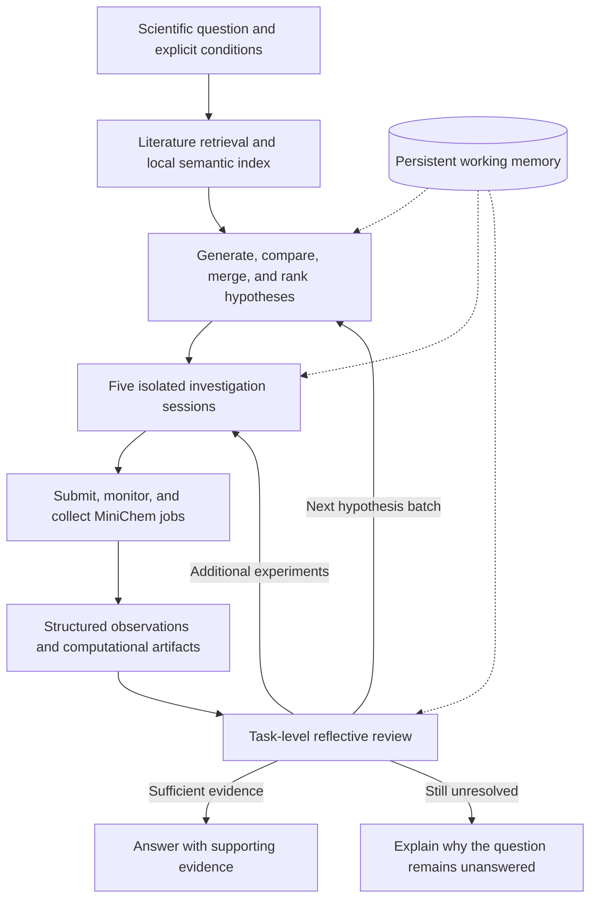

# Arche-Harness

**A recoverable agentic reasoning, reflection, and computational validation framework for ARCHE.**

English | [简体中文](README.zh-CN.md)

[Architecture and contributors](#architecture-and-contributors) · [Research highlights](#research-highlights) · [Quick start](#quick-start) · [Data reproduction](#data-reproduction) · [Documentation](#documentation) · [Citation](#citation) · [License and patents](#license-and-patents)

Arche-Harness builds on ARCHE, a multi-agent system for computational chemistry that connects scientific questions, literature retrieval, competing mechanistic hypotheses, computational experiments, and evidence-based conclusions. It supports research into reaction mechanisms, stereoselectivity, photochemical activation, and interpretable chemical descriptors.

This repository is developed from the original ARCHE code released with Dong Li et al., **“Autonomous Chemical Mechanistic Discovery through Agentic Reasoning and Validation,”** available at [Arvin0313/ARCHE](https://github.com/Arvin0313/ARCHE). Building on that codebase, Arche-Harness restructures the planning–execution–reflection loop after hypothesis formation around a Harness-based architecture, refactors computational-toolbox encapsulation and inheritance, and integrates the ARCHE execution workflow with the toolbox. The current implementation also adds persistent working memory, isolated investigation sessions, and recovery for long-running chemistry jobs so that reasoning, validation, and reflection can continue across interruptions.

> **Release scope.** This repository contains the current `investigation_v2` implementation and a subset of machine-readable case data. The paper describes an earlier Planner/Execution/Reflection implementation; read [Paper and code versions](#paper-and-code-versions) before comparing results. The code is released under the [repository license](LICENSE) for academic and non-commercial research. Patent applications related to ARCHE have been filed.

## Architecture and contributors

Building on ARCHE, this repository substantially reworks the planning–execution–reflection loop after hypothesis formation, together with the toolbox encapsulation and inheritance architecture:

- **Harness-based planning–execution–reflection architecture:** Shijie Wang (王诗杰) and Yifei Cheng (程亦飞). They organized planning, execution, evidence collection, and reflective review after hypothesis formation into a Harness-orchestrated loop. Their work also includes integrating the ARCHE execution workflow with the computational toolbox. The resulting architecture supports isolated investigation sessions, persistent runtime state, and recovery for long-running computational jobs.
- **Computational toolbox refactoring:** Fangyuan Li (李方圆) refactored the computational toolbox.

## What ARCHE can do

- **Compare competing scientific explanations.** Retrieve relevant literature, generate hypotheses from multiple research perspectives, analyze their relationships, and select five hypotheses for computational investigation.
- **Connect reasoning to real computation.** Use the structured MiniChem Toolbox interface for molecular preparation, electronic-structure calculations, reaction-path exploration, and result analysis.
- **Revise conclusions from evidence.** Task Review can request additional experiments, generate another hypothesis batch, or return an evidence-backed answer together with any remaining limitations.
- **Keep an inspectable research record.** Structured observations, computational artifacts, model-call records, and versioned results connect each scientific conclusion to its supporting evidence.
- **Resume long-running investigations.** SQLite working memory and saved session/job identities allow interrupted tasks to resume, including calculations that continue outside a model session.

## Research highlights

The paper evaluates three levels of mechanistic research. **The table summarizes results reported in the paper; a new run of the current code is not guaranteed to reproduce the same conclusions.**

| Case | Scientific question | Reported result | Included data |
|---|---|---|---|
| **1 · Stereoselectivity** | Which transition states control an asymmetric aldol reaction catalyzed by a vicinal diamine? | Major/minor transition-state backbone RMSDs of **0.01/0.15 Å** and a calculated **ΔΔG‡ of 1.9 kcal/mol**, compared with experimental selectivity. | [case1.json](supplementary/case1.json) |
| **2 · Photochemical activation** | How does an α-iodoboronate undergo C–I cleavage under 450 nm irradiation? | Iterative comparisons support photoactivation of a **CsPPh₂-associated complex**, with an excitation energy of approximately **64.0 kcal/mol**, close to the **63.6 kcal/mol** photon energy. | [case2.json](supplementary/case2.json) |
| **3 · Mechanistic descriptor** | Why does bipyridine substitution alter selectivity in nickel-catalyzed migratory cross-coupling? | The **Br–N–N–H torsional distortion energy** provides an interpretable descriptor; ortho substitution reduces the distortion-energy penalty in the studied model complexes. | [case3.json](supplementary/case3.json) |

The paper-specific **ARCHE-Chem** model was trained for computational chemistry from Qwen2.5-7B-Instruct and paired with a reward model for Best-of-N inference. Its weights, reward model, training corpus, and training pipeline are **not included in this repository snapshot**.

## How it works



Each selected hypothesis receives its own investigation session and access scope. MiniChem jobs progress through submit → query → collect, with no more than one uncollected job per session. Sessions may run concurrently, while actual calculations remain subject to shared server-side resource scheduling.

Task Review reads versioned scientific evidence through a read-only interface and does not submit chemistry jobs. Working memory stores task facts and recovery state. A **Run Bundle** is the researcher-facing directory containing status, stage summaries, and computational artifacts for one run.

The bundled MiniChem catalog registers **65 Actions and 28 Backends**. Registration does not mean that every backend is ready on the local machine; execution depends on installed software, model files, and available resources. See the [toolbox reference](third_party/minichem_toolbox/TOOLBOX.md).

### Paper and code versions

| Area | Paper implementation | Current repository |
|---|---|---|
| Workflow | Retrieval → Hypothesis → Planner → Execution → Reflection | Retrieval → Hypothesis → Investigation/Experiment → Task Review |
| Models | GPT-5 and the trained ARCHE-Chem model | Separately configured providers for general chemistry, hypothesis/investigation, and review |
| Tool access | Structured tool catalog and generated workflows | MiniChem MCP services, scoped session access, and a frozen catalog |
| Recovery | Part of execution and error handling | Explicit SQLite state, session identity, job identity, and `--resume-task` |
| Reproduction | Results reported under the paper configuration | Different evidence requirements for data reanalysis, partial computational validation, and new investigations |

`legacy_workflow_v1` remains only for recovering existing legacy tasks. It is not the standard entry point for new tasks. Working memory is required for new V2 tasks; V2 does not support `--disable-memory`.

## Quick start

### 1. Prepare the environment

The full workflow targets **Linux x86_64 and Python 3.11**. The bundled Codex runtime targets Linux; this snapshot does not provide native full-system support for macOS or Windows.

From the repository root:

```bash
bash scripts/bootstrap_reproduction.sh
cp config.local.env.example config.local.env
```

To select a specific Python 3.11 interpreter:

```bash
ARCHE_BOOTSTRAP_PYTHON=/absolute/path/to/python3.11 \
  bash scripts/bootstrap_reproduction.sh
```

For data reanalysis or an initial Top-5 run without installing MiniChem extras:

```bash
ARCHE_SKIP_MINICHEM_BOOTSTRAP=1 bash scripts/bootstrap_reproduction.sh
```

The bootstrap script does **not** download Gaussian, Multiwfn, pretrained model weights, or native software caches. Before using a backend, consult the [MiniChem installation guide](third_party/minichem_toolbox/README.md) and [environment record](third_party/minichem_toolbox/environment-lock/README.md).

### 2. Configure models and retrieval

Fill in `config.local.env` using [the template](config.local.env.example):

| Configuration | Responsibility | Model identity in this snapshot |
|---|---|---|
| `ARCHE_CHEM_API_KEY`, `ARCHE_CHEM_BASE_URL`, `ARCHE_CHEM_MODEL_NAME` | General chemistry, retrieval, hypothesis relationship/ranking, and Gaussian code generation | Default `deepseek-v4-pro`; the Top-5 script selects it explicitly |
| `ARCHE_CODEX_API_KEY`, `ARCHE_CODEX_BASE_URL`, `ARCHE_CODEX_MODEL_NAME` | Default hypothesis formation and Investigation | `gpt-5.6-sol`; Investigation uses `xhigh` reasoning effort |
| `ARCHE_REVIEW_CODEX_API_KEY`, `ARCHE_REVIEW_CODEX_BASE_URL`, `ARCHE_REVIEW_CODEX_MODEL_NAME` | Task Review | `deepseek-v4-pro` |
| `ARCHE_RETRIEVAL_MODEL_PATH` | Local BGE/SentenceTransformer embedding model | An existing local model directory, not a model-repository name |

Investigation and Task Review endpoints must support **Codex Responses and tool calls**. The three provider groups do not inherit credentials from one another. `ARCHE_AGENT_A1_*` is optional and applies only when `ARCHE_HYPOTHESIS_FORMATION_PROVIDER=agent_a1` is selected explicitly.

The embedding model must already exist locally; retrieval does not download it at runtime. Keep `config.local.env` private—it is excluded by [`.gitignore`](.gitignore).

### 3. Run retrieval and generate the Top 5 hypotheses

The first agentic trial requires configured model APIs and a local embedding model, but it does **not** require a running MiniChem service or Gaussian installation. It performs real literature retrieval and model inference and may incur API charges.

```bash
export ARCHE_RUNTIME_ROOT="$PWD/local_data/runtime/my-investigation"
export ARCHE_OUTPUT_ROOT="$ARCHE_RUNTIME_ROOT"
export MINICHEM_PRIVATE_RUNTIME_ROOT="$ARCHE_RUNTIME_ROOT"

bash scripts/run_to_hypothesis_top5.sh \
  --question 'Propose competing activation mechanisms for the deiodination of Ph-CH2-CH2-CHI-BPin by HPPh2 with Cs2CO3 in EtOAc/CPME under 450 nm light. Design computational tests to distinguish these mechanisms.' \
  --pdf-dir "$ARCHE_RUNTIME_ROOT/papers" \
  --index-dir "$ARCHE_RUNTIME_ROOT/index"
```

The script saves five selected hypotheses and stops before Investigation and Task Review. The default retrieval target is **50 deduplicated PDFs**.

### 4. Start a full investigation

Prepare the required chemistry backends. On the **same Linux host**, open three terminals, enter the repository root, and set the same runtime variables in each terminal.

| Terminal | Command | Purpose |
|---|---|---|
| 1 | `bash scripts/start_catalog_bootstrap_mcp.sh` | Read-only tool catalog at `http://127.0.0.1:9011/mcp` |
| 2 | `bash scripts/start_investigation_minichem.sh` | Scope-authenticated chemistry service at `http://127.0.0.1:9012/mcp` |
| 3 | Run the command below | Check both services and start the controller |

```bash
bash scripts/run_end_to_end.sh \
  --question 'Describe the scientific question, molecular identity, experimental conditions, and required evidence.' \
  --pdf-dir "$ARCHE_RUNTIME_ROOT/papers" \
  --index-dir "$ARCHE_RUNTIME_ROOT/index"
```

Replace the example text with your own research question. This command creates a **new task**; it does not continue the earlier Top-5 task. To provide computational units or initial structures explicitly, add `--scientific-input-json /absolute/path/to/scientific-input.json`; see [scientific_input.py](src/chemistry_multiagent/utils/scientific_input.py) for accepted fields and validation rules.

The service scripts default to a budget of **60 CPU cores, 320000 MB of memory, and 1 GPU**. These are service settings, not universal minimum requirements or automatically detected capacity. Adjust `RESEARCHCHEMBENCH_AVAILABLE_CPU_CORES`, `RESEARCHCHEMBENCH_AVAILABLE_MEMORY_MB`, and `RESEARCHCHEMBENCH_AVAILABLE_GPU_COUNT` to match the deployment while satisfying the [ARCHE resource policy](src/chemistry_multiagent/tools/minichem_resource_policy.json).

Use `--max-parallel-investigations 1` to reduce investigation concurrency. The standard batch still selects five hypotheses.

## Data reproduction

The three JSON datasets support low-cost deterministic checks after Python dependencies are installed. These commands analyze stored results only; they do not call an LLM, start an MCP service, or run Gaussian:

```bash
export PYTHONPATH=src:third_party/minichem_toolbox/src
mkdir -p local_data/runtime/data-reanalysis

.venv/bin/python scripts/reproduce_case1.py \
  --output local_data/runtime/data-reanalysis/case1_report.json

.venv/bin/python scripts/reproduce_case23.py \
  --output local_data/runtime/data-reanalysis/case23_report.json
```

| Case | Expected report | Interpretation |
|---|---|---|
| 1 | `passed_with_source_discrepancies`; ΔΔG‡ ≈ **1.8848503 kcal/mol** | Reproduces the stored major/minor free-energy difference. The JSON has 14 candidate records, while the paper reports 12 validated transition states; it also contains a TS-2c energy discrepancy and no IRC records. |
| 2 | `passed_with_source_discrepancy` | Reanalyzes barriers and excitation energies. Stored energies give a complex-formation ΔG ≈ **−4.617842 kcal/mol**, versus **−3.0 kcal/mol** in the supporting information. |
| 3 | `passed_with_missing_published_wiberg_values` | Reproduces the distortion-energy trend; the included JSON does not contain the reported Wiberg bond-index values. |

Distinguish among reanalysis of released data, recalculation from supplied structures, and an independent investigation from the scientific question. Each level requires different software, inputs, computational resources, and scientific validation. See [Delivery and Reproduction](docs/current/DELIVERY_AND_REPRODUCTION.md) for details.

## Results and recovery

Run results are stored below the private output root:

```text
<ARCHE_OUTPUT_ROOT>/outputs/
├── latest.json
├── index.json
└── runs/<run-id>/
    ├── README.md
    ├── run.json
    ├── status.json
    ├── summary.json
    ├── stages/
    ├── artifacts/
    └── internal/
        ├── state/
        ├── audit/
        └── catalog/
```

Read `status.json` and `summary.json` first. `waiting_investigation_job` means a submitted job is still waiting to finish or be collected; it is not a final scientific answer.

To resume, preserve the original code, model configuration, runtime directory, working memory, and tool catalog, then run:

```bash
bash scripts/run_end_to_end.sh --resume-task YOUR_TASK_ID
```

If the task was created with `--memory-db`, pass the same path again. A resume command must not introduce a new question, scientific-input file, or task budget. Completed model turns can be replayed from receipts, while interrupted turns continue in the original session and query the original job. If the task again returns `waiting_investigation_job`, rerun the same resume command later.

## Scientific scope and limitations

ARCHE supports research exploration and computational validation only within the installed tool catalog. Domain experts must review chemical identity, atom balance, stereochemistry, charge and spin, computational method, solvent and temperature assumptions, convergence, frequencies, and reaction-path connectivity where applicable.

A completed job or affirmative model judgment does not by itself establish a reaction mechanism. Transition-state guesses require validation; agreement between a vertical excitation energy and a light source does not prove a full photochemical pathway; and a torsional descriptor in model complexes should not be generalized without further evidence.

Model sampling, API changes, and literature availability may alter generated hypotheses and workflows. For reproducible research, retain the code snapshot, dependency versions, model/provider identities, structures and conditions, corpus manifest, frozen tool catalog, complete Run Bundle, and records of supplied hypotheses or human intervention.

Scientific questions and related content are sent to the configured model services. Run Bundles may contain unpublished chemical information, model responses, and execution records. Keep credentials and raw runtime data private, and share only reviewed scientific artifacts.

## Documentation

| Entry point | Contents |
|---|---|
| [Documentation index](docs/README.md) | Current guides and dated research evidence |
| [Code architecture](ARCHE_CODE_ARCHITECTURE.md) | Controller flow, module responsibilities, memory, service boundaries, and recovery contracts |
| [MiniChem README](third_party/minichem_toolbox/README.md) / [Toolbox reference](third_party/minichem_toolbox/TOOLBOX.md) | Backend configuration, capabilities, inputs, and outputs |
| [Codex runtime](third_party/codex_cli/0.149.0/README.md) | Bundled CLI 0.149.0, archive integrity, and runtime layout |
| [Delivery and reproduction](docs/current/DELIVERY_AND_REPRODUCTION.md) | Implementation scope and evidence limitations |

```text
src/chemistry_multiagent/
├── agents/           # Retrieval and hypothesis agents; legacy agents are retained
├── controllers/      # Public CLI and investigation orchestration
├── investigation/    # Sessions, evidence, review, and job recovery
├── memory/           # SQLite events, facts, indexes, and views
├── tools/            # MiniChem adapters, catalog freezing, and resource policy
├── harness/          # Codex integration and legacy compatibility
└── utils/            # Model routing, prompts, scientific input, and Run Bundles
scripts/              # Installation, services, task execution, and data reanalysis
supplementary/        # Case data and controlled experimental inputs
tests/                # Contract, orchestration, recovery, and regression tests
third_party/          # MiniChem Toolbox and bundled Codex CLI/SDK
```

### Tests

After preparing the standard environment:

```bash
HF_HUB_OFFLINE=1 TRANSFORMERS_OFFLINE=1 \
PYTHONPATH=src:third_party/minichem_toolbox/src \
  .venv/bin/python -m pytest -q tests

HF_HUB_OFFLINE=1 TRANSFORMERS_OFFLINE=1 \
PYTHONPATH=src:third_party/minichem_toolbox/src \
  .venv/bin/python -m pytest -q third_party/minichem_toolbox/tests
```

Passing tests verifies interfaces and regression expectations; it does not demonstrate that a new reaction has been reproduced or that every external service is configured.

## Citation

If ARCHE contributes to your research, cite the associated manuscript and record the exact code snapshot and runtime configuration. The following metadata is based on the supplied manuscript and does not claim journal acceptance, a DOI, or a public preprint identifier.

```bibtex
@unpublished{li_arche,
  title  = {Autonomous Chemical Mechanistic Discovery through Agentic Reasoning and Validation},
  author = {Li, Dong and Mi, Sixuan and Ye, Zihao and Xiong, Huan and Xu, Tao
            and Zhu, Tong and Zhang, Aijia and Gao, Junqi and Zhang, Kaiyan
            and Wang, Shijie and Zhou, Bowen and Li, Yuqiang and Qi, Biqing},
  note   = {Manuscript accompanying the ARCHE research system}
}
```

Also cite and acknowledge the chemistry software and models used in each actual computation according to their respective requirements.

## License and patents

Materials owned by the ARCHE authors are released under the **Academic and Non-Commercial Research License, version 1.0**. See [LICENSE](LICENSE) for the complete terms; this summary does not replace or expand the license.

- Academic research, academic evaluation, teaching, and non-commercial reproduction are permitted subject to the license definitions and conditions.
- Commercial use—including internal commercial R&D, paid consulting or contract research with a commercial interest, integration into commercial products, and hosted/API/SaaS services—requires separate prior written permission.
- Patent applications related to ARCHE have been filed. The repository license grants **no express or implied patent license**.
- Third-party materials retain their own terms, including the [MiniChem Toolbox](third_party/minichem_toolbox/LICENSE), [Codex CLI](third_party/codex_cli/0.149.0/LICENSE), [Codex Python SDK](third_party/codex_python_sdk/LICENSE), and [ASH](third_party/minichem_toolbox/vendor/ash-0.95/LICENSE).

This is a **source-available research release**, not an OSI-approved open-source release. The software is provided “as is”; warranty and liability limitations are governed by LICENSE.

## Contact and contributions

For project questions, research collaboration, or commercial/patent licensing, contact **Dong Li at [arvinlee826@gmail.com](mailto:arvinlee826@gmail.com)**. For manuscript-related academic questions, contact [Yuqiang Li](mailto:liyuqiang@pjlab.org.cn), or [Biqing Qi](mailto:qibiqing@pjlab.org.cn).

Issue reports, documentation improvements, and reproduction feedback are welcome. Include the code version, runtime environment, minimal input, expected and observed behavior, and redacted error details.
