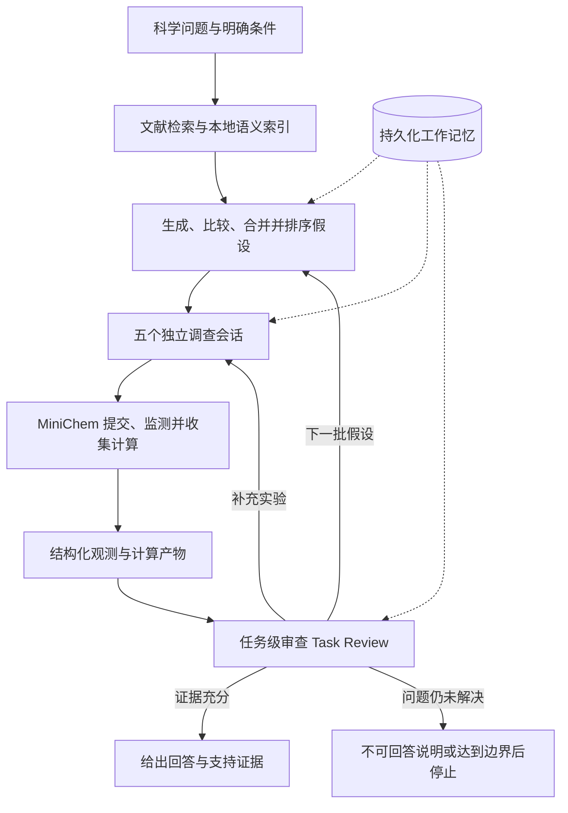

# Arche-Harness

**面向 ARCHE 的可恢复智能体推理、反思与计算验证框架。**

[English](README.md) | 简体中文

[架构优化与贡献](#架构优化与贡献) · [研究亮点](#研究亮点) · [快速开始](#快速开始) · [数据复现](#数据复现) · [文档导航](#文档导航) · [引用](#引用) · [许可与专利](#许可与专利)

Arche-Harness 基于 ARCHE 构建。ARCHE 是面向计算化学研究的多智能体系统，将科学问题、文献检索、竞争性机理假设、计算实验和基于证据的结论连接起来，服务于反应机理、立体选择性、光化学活化和可解释化学描述符等研究问题。本仓库聚焦于提升长时间研究任务中的执行编排、反思审查、状态恢复与计算工具接入能力。

本仓库基于 Dong Li 等人论文 **“Autonomous Chemical Mechanistic Discovery through Agentic Reasoning and Validation”** 配套发布的 ARCHE 原始代码 [Arvin0313/ARCHE](https://github.com/Arvin0313/ARCHE) 开发。在该代码基础上，Arche-Harness 重点将假设生成之后的规划—执行—反思链路重构为基于 Harness 的架构，重构计算工具箱的封装与继承，并完成 ARCHE 执行流程与计算工具箱的集成。当前实现还引入了持久化工作记忆、独立调查会话和长时间化学作业恢复，支持持续推进推理、验证与反思循环。

> **发布范围。** 本仓库提供当前 `investigation_v2` 实现和部分可机器读取的案例数据。论文描述的是较早的 Planner/Execution/Reflection 实现；比较运行结果前，请阅读[论文与代码版本](#论文与代码版本)。代码依据[仓库许可证](LICENSE)公开，用于学术与非商业研究；与 ARCHE 相关的专利已经申请。

## 架构优化与贡献

本仓库在 ARCHE 基础上重点重构了假设生成之后的规划—执行—反思链路，以及工具箱的封装与继承体系：

- **基于 Harness 的规划—执行—反思架构：** 王诗杰、程亦飞。将假设生成之后的规划、执行、证据回收与反思审查组织为由 Harness 编排的闭环；同时负责 ARCHE 执行流程与计算工具箱的集成，并支持独立调查会话、持久化运行状态和长时间计算任务恢复。
- **计算工具箱重构：** 李方圆。负责计算工具箱的重构。

## ARCHE 能做什么？

- **比较不同科学解释。** 检索相关文献，从多个研究角度提出假设，分析假设之间的关系，并筛选五个假设进入计算调查。
- **将推理连接到真实计算。** 通过 MiniChem Toolbox 的结构化接口完成分子准备、电子结构计算、反应路径探索和结果分析。
- **依据证据修订。** Task Review 审查当前批次的结果，可以要求补充实验、生成下一批假设，或给出有证据支持的回答及问题仍无法回答的原因。
- **保留可检查的研究记录。** 结构化观测、计算产物、模型调用记录和结果版本，将科学问题与结论所依赖的证据关联起来。
- **继续长时间调查。** SQLite 工作记忆及保存的会话、作业身份支持显式恢复中断任务，包括仍在模型会话之外运行的计算作业。

## 研究亮点

论文通过三个案例考察不同层次的机理研究能力。**下表为论文报告的研究结果，不代表当前代码的新运行一定得到相同结论。**

| 案例 | 科学问题 | 论文报告的发现 | 随附数据 |
|---|---|---|---|
| **1 · 立体选择性** | 哪些过渡态控制邻位二胺催化的不对称 aldol 反应？ | 主要与次要路径过渡态骨架 RMSD 分别为 **0.01/0.15 Å**，计算 **ΔΔG‡ 为 1.9 kcal/mol**，并与实验选择性比较。 | [case1.json](supplementary/case1.json) |
| **2 · 光化学活化** | α-碘硼酸酯如何在 450 nm 光照下发生 C–I 键断裂？ | 通过迭代比较支持 **CsPPh₂ 关联复合物的光活化解释**，相关激发能约 **64.0 kcal/mol**，接近光子能量 **63.6 kcal/mol**。 | [case2.json](supplementary/case2.json) |
| **3 · 机理描述符** | 联吡啶取代方式为何改变镍催化迁移交叉偶联的选择性？ | **Br–N–N–H 二面角扭转畸变能**构成可解释的描述符；在所研究的模型配合物中，邻位取代降低畸变能代价。 | [case3.json](supplementary/case3.json) |

论文中的专用模型 **ARCHE-Chem** 基于 Qwen2.5-7B-Instruct 进行计算化学领域训练，并结合奖励模型进行 Best-of-N 推理。其权重、奖励模型、训练语料和训练流程**未包含在当前仓库快照中**。当前代码的 API 配置见下文。

## 工作原理



每个入选假设获得独立的调查会话和访问范围。会话内的 MiniChem 作业按“提交 → 查询 → 收集”推进，同一时间最多保留一个尚未收集结果的作业。多个会话可以并发运行，实际计算受服务端共享资源调度约束。

Task Review 通过只读证据接口读取当前批次已验证的科学结果版本，不提交化学计算。工作记忆保存任务事实和恢复状态；**Run Bundle** 是供研究人员查看状态、阶段摘要和计算产物的一次运行结果目录。

随附 MiniChem 目录注册了 **65 个 Action 和 28 个 Backend**，分别表示计算操作和后端实现。注册接口不等于本机已经具备执行条件；实际运行取决于软件、模型文件和资源是否就绪。支持的操作及输入输出约定见[工具箱参考](third_party/minichem_toolbox/TOOLBOX.md)。

### 论文与代码版本

| 项目 | 论文中的实现 | 当前仓库 |
|---|---|---|
| 流程 | Retrieval → Hypothesis → Planner → Execution → Reflection | Retrieval → Hypothesis → Investigation/Experiment → Task Review |
| 模型 | GPT-5 与训练后的 ARCHE-Chem 专用模型 | 分别配置通用化学、假设形成/调查和审查 provider |
| 工具接入 | 结构化工具目录与生成的工作流 | MiniChem MCP 服务、会话访问范围和冻结目录 |
| 恢复 | 执行及错误处理的一部分 | 显式 SQLite 状态、会话身份、作业身份和 `--resume-task` |
| 复现 | 论文配置下报告的研究结果 | 数据重分析、部分计算验证和新任务调查各有不同的证据要求 |

`legacy_workflow_v1` 模块保留用于恢复已有旧任务，不是新任务的标准入口。当前新任务要求启用工作记忆；V2 流程不支持 `--disable-memory`。

## 快速开始

<a id="运行要求"></a>

### 1. 准备运行环境

完整流程支持的目标环境是 **Linux x86_64 与 Python 3.11**。随附的 Codex 运行时面向 Linux；当前快照不提供完整系统在 macOS 或 Windows 上的原生运行支持。

下载本仓库后，**从仓库根目录**执行以下命令：

```bash
bash scripts/bootstrap_reproduction.sh
cp config.local.env.example config.local.env
```

安装脚本创建仓库内的 `.venv`，安装 ARCHE 依赖、随附 Codex Python SDK 和 MiniChem 的 Python 依赖。如需明确指定 Python 3.11 解释器：

```bash
ARCHE_BOOTSTRAP_PYTHON=/absolute/path/to/python3.11 \
  bash scripts/bootstrap_reproduction.sh
```

如果只做**数据重分析或第一次 Top 5 试运行**，可以跳过 MiniChem 的附加安装：

```bash
ARCHE_SKIP_MINICHEM_BOOTSTRAP=1 bash scripts/bootstrap_reproduction.sh
```

启动化学服务前需执行完整安装。安装脚本**不会**下载 Gaussian、Multiwfn、预训练模型权重或原生软件缓存。安装报告会列出不可用的后端；安装成功不表示所有化学后端都已就绪。请根据计划使用的操作，查阅 [MiniChem 安装说明](third_party/minichem_toolbox/README.md)和[环境记录](third_party/minichem_toolbox/environment-lock/README.md)。

### 2. 配置模型与检索

参照[配置模板](config.local.env.example)填写 `config.local.env`。标准 API 路线为各组配置独立的凭据和端点：

| 配置 | 职责 | 当前快照中的模型身份 |
|---|---|---|
| `ARCHE_CHEM_API_KEY`、`ARCHE_CHEM_BASE_URL`、`ARCHE_CHEM_MODEL_NAME` | 通用化学调用、检索、假设关系/排序和 Gaussian 代码生成 | 默认 `deepseek-v4-pro`；Top 5 脚本会显式选择该模型 |
| `ARCHE_CODEX_API_KEY`、`ARCHE_CODEX_BASE_URL`、`ARCHE_CODEX_MODEL_NAME` | 默认假设形成与 Investigation 调查 | `gpt-5.6-sol`；Investigation 使用 `xhigh` 推理强度 |
| `ARCHE_REVIEW_CODEX_API_KEY`、`ARCHE_REVIEW_CODEX_BASE_URL`、`ARCHE_REVIEW_CODEX_MODEL_NAME` | Task Review 任务级审查 | `deepseek-v4-pro` |
| `ARCHE_RETRIEVAL_MODEL_PATH` | 本地 BGE/SentenceTransformer 嵌入模型 | 已存在的本地模型目录，不能填写模型仓库名称 |

Investigation 与 Task Review 的端点必须兼容 **Codex Responses 和工具调用**；仅支持 Chat Completions 的端点不足以运行这两类会话。三组 provider 不会相互继承凭据。上表是代码要求的模型身份，实际访问能力需由所配置的服务提供；模型名称本身不能证明端点兼容。

可选的 `ARCHE_AGENT_A1_*` 配置仅在明确选择 `ARCHE_HYPOTHESIS_FORMATION_PROVIDER=agent_a1` 时使用。它改变假设形成的 provider，不改变 Investigation 或 Review 的职责。

嵌入模型需提前准备。检索从本地加载模型，不会在运行时下载；即使使用 `--no-search`，仍然需要嵌入模型和模型 API 调用。请妥善保存 `config.local.env`，该文件已被 [`.gitignore`](.gitignore)排除。

### 3. 先运行文献检索与 Top 5 假设

第一次智能体试运行需要已配置的模型 API 和本地嵌入模型，但**不需要启动 MiniChem 服务或安装 Gaussian**。它会进行真实文献检索与假设生成，可能产生 API 费用。

选择私有运行目录。下面使用仓库中被忽略的 `local_data/runtime/`：

```bash
export ARCHE_RUNTIME_ROOT="$PWD/local_data/runtime/my-investigation"
export ARCHE_OUTPUT_ROOT="$ARCHE_RUNTIME_ROOT"
export MINICHEM_PRIVATE_RUNTIME_ROOT="$ARCHE_RUNTIME_ROOT"

bash scripts/run_to_hypothesis_top5.sh \
  --question 'Propose competing activation mechanisms for the deiodination of Ph-CH2-CH2-CHI-BPin by HPPh2 with Cs2CO3 in EtOAc/CPME under 450 nm light. Design computational tests to distinguish these mechanisms.' \
  --pdf-dir "$ARCHE_RUNTIME_ROOT/papers" \
  --index-dir "$ARCHE_RUNTIME_ROOT/index"
```

该示例要求提出蓝光驱动脱碘反应的竞争性活化机制，并设计区分这些机制的计算实验。成功后保存五个入选假设，在 Investigation 和 Task Review 之前结束。默认检索目标为 **50 篇去重 PDF**。如果检索未完成，请查看 manifest，并使用[论文检索恢复方法](#论文检索与冻结语料)。

### 4. 启动完整调查

先准备所需化学后端。在**同一台 Linux 主机打开三个终端**，都进入仓库根目录，并在每个终端设置与第 3 步相同的三个运行目录变量。

| 终端 | 命令 | 用途 |
|---|---|---|
| 1 | `bash scripts/start_catalog_bootstrap_mcp.sh` | `http://127.0.0.1:9011/mcp` 上的只读工具目录 |
| 2 | `bash scripts/start_investigation_minichem.sh` | `http://127.0.0.1:9012/mcp` 上带访问范围认证的化学执行服务 |
| 3 | 执行下方命令 | 检查两个服务并启动控制器 |

```bash
bash scripts/run_end_to_end.sh \
  --question '在此说明科学问题、分子身份、实验条件，以及希望检验的证据。' \
  --pdf-dir "$ARCHE_RUNTIME_ROOT/papers" \
  --index-dir "$ARCHE_RUNTIME_ROOT/index"
```

将示例文字替换为自己的研究问题。该命令会创建**新任务**，不会继续前面的 Top 5 任务。不同科学问题使用独立的论文和索引目录；已有准备完成的语料时，请添加下文的冻结语料参数。

如需明确提供计算单元或初始结构，添加 `--scientific-input-json /absolute/path/to/scientific-input.json`。接受的字段与校验规则见 [scientific_input.py](src/chemistry_multiagent/utils/scientific_input.py)。请说明所给结构和条件的来源；`supplementary/` 中的作者夹具属于受控实验输入。

服务脚本默认预算为 **60 个 CPU 核、320000 MB 内存和 1 个 GPU**。这些数值是服务配置，不是所有任务的最低需求，也不是自动检测的硬件容量。Gaussian 使用 CPU 计算，部分其他后端需要 GPU 或额外模型。部署人员可在启动服务前设置 `RESEARCHCHEMBENCH_AVAILABLE_CPU_CORES`、`RESEARCHCHEMBENCH_AVAILABLE_MEMORY_MB` 和 `RESEARCHCHEMBENCH_AVAILABLE_GPU_COUNT`；最终配置必须满足服务约定和 [ARCHE 资源政策](src/chemistry_multiagent/tools/minichem_resource_policy.json)。Gaussian 的 CPU/内存由服务控制，模型生成的请求不能覆盖。

如需降低调查并发，添加 `--max-parallel-investigations 1`；标准批次仍会选择五个假设。运行时间与费用取决于分子、方法、候选数量、模型服务和修订过程；论文中的案例耗时不是通用运行时间估计。

## 数据复现

三个 JSON 数据集提供了**安装 Python 依赖之后**可做的低成本确定性检查。下列命令只分析已有解析结果，不调用 LLM、不启动 MCP 服务，也不执行 Gaussian：

```bash
export PYTHONPATH=src:third_party/minichem_toolbox/src
mkdir -p local_data/runtime/data-reanalysis

.venv/bin/python scripts/reproduce_case1.py \
  --output local_data/runtime/data-reanalysis/case1_report.json

.venv/bin/python scripts/reproduce_case23.py \
  --output local_data/runtime/data-reanalysis/case23_report.json
```

随附数据的预期结果：

| 案例 | 预期报告 | 含义 |
|---|---|---|
| 1 | `passed_with_source_discrepancies`；ΔΔG‡ ≈ **1.8848503 kcal/mol** | 重现存储数据中的主/次路径自由能差。JSON 含 14 条候选记录，论文报告 12 个已验证 TS；另有 TS-2c 能量差异，且 JSON 未包含 IRC 记录。 |
| 2 | `passed_with_source_discrepancy` | 重分析势垒和激发能。存储能量给出的复合物形成 ΔG ≈ **−4.617842 kcal/mol**，SI 报告值为 **−3.0 kcal/mol**。 |
| 3 | `passed_with_missing_published_wiberg_values` | 重现存储数据中的畸变能趋势；随附 JSON 未包含文中报告的 Wiberg 键指数数值。 |

Case 2/3 合并报告的顶层状态为 `status: completed`，还需查看每个案例的检查项与限制。上述差异标签是预期的数据审计结果，不是安装错误。

比较复现结果时，请区分三个层次：

| 层次 | 验证内容 | 额外要求 |
|---|---|---|
| **发布数据重分析** | 已有结果的算术、单位、排序和一致性 | 随附 JSON 文件与重分析脚本 |
| **从给定结构重算** | 能否从发布几何和选定设置重复计算 | 已授权/安装的后端、明确计算协议、计算资源和输出的科学验证 |
| **从题面独立调查** | 假设生成、结构准备、计算和依据证据修订 | 完整科学输入、模型服务、文献语料、工具及输入/人工干预记录 |

两个脚本通过 `--help` 提供额外的真实计算选项，但这些是研究验证工具，其中部分仍采用本地或旧版服务路线，不能与 V2 端到端入口直接互换。同样，`*_author_main_hypothesis*.json` 文件为受控实验提供作者选定的假设或条件，使用这些文件不能证明系统独立发现了假设。

详见[复现总览](docs/current/DELIVERY_AND_REPRODUCTION.md)、[Case 1 输入限制](docs/research/CASE1_REPRODUCTION_INPUT_LIMITATIONS.md)、[Case 1 验证](docs/research/CASE1_STEPWISE_VALIDATION_2026-08-17.md)、[Case 2 验证](docs/research/CASE2_STEPWISE_VALIDATION_2026-08-17.md)，以及 [Case 2](docs/research/CASE2_HUMAN_INPUT_AUDIT_2026-08-19.md)/[Case 3](docs/research/CASE3_HUMAN_INPUT_AUDIT_2026-08-19.md) 输入审计。这些是带日期的研究记录，可能引用较早的论文或运行环境快照。

## 论文检索与冻结语料

<a id="6-单独检索论文"></a>

独立论文检索入口下载并校验 PDF、记录文件哈希，支持中断恢复；它不构建语义索引，也不启动假设生成。与 shell 入口不同，使用该入口前需明确把私有配置加载到环境：

```bash
set -a
source config.local.env
set +a
export PYTHONPATH=src:third_party/minichem_toolbox/src
export PAPER_SEARCH_ROOT="$PWD/local_data/runtime/paper-search"
mkdir -p "$PAPER_SEARCH_ROOT/papers"

.venv/bin/python scripts/run_paper_search_only.py \
  --question '填写与后续调查一致的科学问题。' \
  --model-path "$ARCHE_RETRIEVAL_MODEL_PATH" \
  --pdf-dir "$PAPER_SEARCH_ROOT/papers" \
  --manifest "$PAPER_SEARCH_ROOT/manifest.json" \
  --resume-state "$PAPER_SEARCH_ROOT/resume.json" \
  --response-cache-dir "$PAPER_SEARCH_ROOT/cache" \
  --provider-strategy pypaperbot_scholar \
  --target-papers 50
```

检索完成要求 manifest 中 `status: completed`、`target_reached: true`，且去重 PDF 数量达到目标。中断后重新执行时，保持问题、provider、目标数量、语料、恢复文件和缓存不变。如需各次重试使用完全相同的关键词，请从首次运行起通过 `--keywords-json` 指定同一组 5–10 个关键词。

同一个恢复文件会跳过已经尝试过的关键词，包括失败项。如果剩余关键词已用尽，请保留现有 PDF 和成功缓存，等待服务冷却时间结束后，使用新的恢复文件名发起下一轮，并保留旧文件供审计。遵守论文来源与检索服务的访问条件；当前路线使用公开链接的 PDF，不提供付费墙访问能力。

将完成的语料交给 Top 5 或完整端到端脚本时，使用：

```bash
--pdf-dir "$PAPER_SEARCH_ROOT/papers" \
--index-dir "$PAPER_SEARCH_ROOT/index" \
--no-search \
--paper-search-manifest "$PAPER_SEARCH_ROOT/manifest.json"
```

以上是附加参数，不是独立命令。控制器会检查 manifest 完成状态、PDF 数量和语料指纹。`--no-search` 只跳过在线获取论文，不表示智能体流程完全离线。

## 查看结果与恢复任务

结果保存在私有输出根目录：

```text
<ARCHE_OUTPUT_ROOT>/outputs/
├── latest.json                       # 最近一次运行的 ID 和位置
├── index.json                        # 运行索引
└── runs/<run-id>/
    ├── README.md
    ├── run.json
    ├── status.json                   # 首先查看：当前运行状态
    ├── summary.json                  # 阶段与结果摘要
    ├── stages/                       # 结构化阶段结果
    ├── artifacts/                    # 计算产物
    └── internal/
        ├── state/                    # 工作记忆与会话状态
        ├── audit/                    # 模型调用记录
        └── catalog/                  # 冻结工具目录
```

解读结果前先查看 `status.json` 和 `summary.json`。`waiting_investigation_job` 表示已提交的作业仍在等待完成或收集，不是最终科学回答。

继续任务时，保留原代码、模型配置、运行目录、工作记忆和工具目录。复用尚在运行的服务，或使用原运行目录重新启动服务。从 `outputs/latest.json` 的 `run_id` 字段读取任务 ID，再执行：

```bash
bash scripts/run_end_to_end.sh --resume-task YOUR_TASK_ID
```

如果创建任务时使用了 `--memory-db`，恢复时再次传入同一路径；否则入口会定位原 Run Bundle 中的 `internal/state/arche_memory.sqlite3`。恢复命令不应添加新的问题、科学输入文件或任务预算。

恢复会复用保存的会话和作业身份。已经完成的模型回合可以通过回执重放，避免再次调用模型；中断回合可以在原 thread 中继续查询并收集原作业。如果再次返回 `waiting_investigation_job`，稍后重复相同恢复命令。恢复状态缺失或冲突时，系统会停止，而不是新建替代作业。请完整保留运行目录。

## 科学适用范围与限制

ARCHE 在已安装工具目录的范围内支持研究探索和计算验证。结果需要领域人员审阅，包括化学身份、原子守恒、立体化学、电荷与自旋、计算方法、溶剂与温度假设、收敛、频率，以及适用时的反应路径连通性。

作业完成或模型给出肯定判断，不能单独证明反应机理成立。过渡态初猜仍需后续验证；垂直激发能与光源匹配不能证明完整光化学路径；模型配合物中的扭转描述符也不能直接推广为普适选择性定律。

模型采样和 API 变化可能改变生成的假设与工作流，文献可获取性也会变化。开展可复现研究时，请保存代码快照、依赖版本、模型/provider 身份、输入结构与条件、语料 manifest、冻结工具目录和完整 Run Bundle，并披露给定假设、参考几何和人工干预。

科学问题与相关内容会发送给配置的模型服务。Run Bundle 可能包含未发表化学信息、模型响应和运行记录。请私密保存凭据与原始运行数据，报告结果时分享经过审阅的科学产物。Gaussian 等第三方软件及模型文件需要分别满足相应的访问与许可条件。

## 文档导航

| 入口 | 内容 |
|---|---|
| [文档索引](docs/README.md) | 当前指南与带日期的研究证据 |
| [代码架构说明](ARCHE_CODE_ARCHITECTURE.md) | 控制器流程、模块职责、记忆、服务边界与恢复约定 |
| [MiniChem README](third_party/minichem_toolbox/README.md) / [工具箱参考](third_party/minichem_toolbox/TOOLBOX.md) | 后端配置、能力、输入与输出 |
| [Codex 运行时](third_party/codex_cli/0.149.0/README.md) | 随附 CLI 0.149.0、归档完整性和运行目录布局 |
| [交付与复现说明](docs/current/DELIVERY_AND_REPRODUCTION.md) | 实现范围与证据限制 |

详细架构与研究记录目前主要使用中文。

```text
src/chemistry_multiagent/
├── agents/           # 检索与假设智能体；同时保留旧版智能体
├── controllers/      # 公开命令行入口与调查任务编排
├── investigation/    # 调查会话、证据、审查与作业恢复
├── memory/           # SQLite 事件、事实、索引与视图
├── tools/            # MiniChem 适配、目录冻结与资源政策
├── harness/          # Codex 集成与旧版兼容
└── utils/            # 模型路由、提示词、科学输入与 Run Bundle
scripts/              # 安装、服务启动、任务运行与数据重分析
supplementary/        # 案例数据与受控实验输入
tests/                # 接口约定、任务编排、恢复与回归测试
third_party/          # MiniChem Toolbox 和随附 Codex CLI/SDK
```

查看完整控制器参数：

```bash
PYTHONPATH=src:third_party/minichem_toolbox/src \
  .venv/bin/python -m chemistry_multiagent.controllers.chemistry_multiagent_controller --help
```

### 测试与常见问题

准备标准环境后，运行仓库测试：

```bash
HF_HUB_OFFLINE=1 TRANSFORMERS_OFFLINE=1 \
PYTHONPATH=src:third_party/minichem_toolbox/src \
  .venv/bin/python -m pytest -q tests

HF_HUB_OFFLINE=1 TRANSFORMERS_OFFLINE=1 \
PYTHONPATH=src:third_party/minichem_toolbox/src \
  .venv/bin/python -m pytest -q third_party/minichem_toolbox/tests
```

测试包括注入/模拟 provider 和接口约定检查。测试通过不能证明新反应已复现，也不能证明所有外部服务均已配置。

| 现象 | 检查方法 |
|---|---|
| 缺少标准 Python | 从仓库根目录运行安装脚本；启动入口要求使用仓库内 `.venv/bin/python`。 |
| 缺少本地嵌入模型 | 将 `ARCHE_RETRIEVAL_MODEL_PATH` 指向完整的本地 SentenceTransformer 模型目录。 |
| Provider 或模型身份被拒绝 | 检查三组独立配置，以及 Responses/工具调用支持。 |
| 9011/9012 就绪检查失败 | 使用相同运行目录变量启动正确的两个服务；只有端口开放还不够。 |
| 后端不可用 | 依据 MiniChem 指南安装并配置该后端及所需模型文件。 |
| 语料未完成 | 查看 manifest，并使用论文检索重试流程。 |
| 任务等待化学计算 | 查看原 Run Bundle，使用原运行目录执行 `--resume-task`。 |

## 引用

如果 ARCHE 对你的研究有帮助，请引用对应论文，并记录实际使用的代码快照与运行配置。以下书目信息以提供的论文稿件为依据，不表示期刊录用，也不声称已有 DOI 或公开预印本编号。

```bibtex
@unpublished{li_arche,
  title  = {Autonomous Chemical Mechanistic Discovery through Agentic Reasoning and Validation},
  author = {Li, Dong and Mi, Sixuan and Ye, Zihao and Xiong, Huan and Xu, Tao
            and Zhu, Tong and Zhang, Aijia and Gao, Junqi and Zhang, Kaiyan
            and Wang, Shijie and Zhou, Bowen and Li, Yuqiang and Qi, Biqing},
  note   = {Manuscript accompanying the ARCHE research system}
}
```

同时，请按各项目要求引用和致谢实际计算中使用的化学软件及模型。

## 许可与专利

ARCHE 作者拥有相应权利的材料采用 **Academic and Non-Commercial Research License, version 1.0（学术与非商业研究许可证）**。完整条款见 [LICENSE](LICENSE)；本节为摘要，不替代或扩大许可证授权。

- **允许的范围：** 在许可证定义和条件下，用于学术研究、学术评估、教学和非商业复现。分享副本时保留声明和许可证，明确标记修改，并在学术惯例要求时提供引用。
- **以下用途需事先取得单独书面许可：** 商业使用，包括企业内部商业研发、有商业利益的付费咨询或合同研究、集成至商业产品，以及托管/API/SaaS 服务。许可证中的托管服务限制同样适用。
- **专利说明：** 与 ARCHE 相关的专利已经申请。仓库许可证**不授予任何明示或默示的专利许可**。公开代码不授予任何专利或专利申请项下的权利；本说明不表示专利已经授权。
- **第三方材料保持各自条款。** 例如 [MiniChem Toolbox](third_party/minichem_toolbox/LICENSE)、[Codex CLI](third_party/codex_cli/0.149.0/LICENSE)、[Codex Python SDK](third_party/codex_python_sdk/LICENSE) 和 [ASH](third_party/minichem_toolbox/vendor/ash-0.95/LICENSE)，以及其他随附或另行安装组件的适用声明。

本项目属于**源码可见的研究发布（source-available research release）**，不采用 OSI 批准的开源许可证。软件按“现状”提供，保证与责任限制以 LICENSE 为准。上述术语与[开源定义](https://opensource.org/osd)一致：仅允许非商业使用的限制不符合该定义。

## 联系与贡献

项目咨询、科研合作、商业或专利许可询问，请联系 LICENSE 中列明的 **Dong Li：[arvinlee826@gmail.com](mailto:arvinlee826@gmail.com)**。论文相关学术问题也可联系稿件列明的通讯作者：[Bowen Zhou](mailto:zhoubowen@tsinghua.edu.cn)、[Yuqiang Li](mailto:liyuqiang@pjlab.org.cn) 和 [Biqing Qi](mailto:qibiqing@pjlab.org.cn)。

欢迎问题报告、文档改进和复现反馈。请附上代码版本、运行环境、最小输入、预期与实际行为，以及脱敏错误信息。修改任务编排或恢复逻辑前，请阅读架构说明并验证相应测试；分享数据与第三方材料前，请核对其可分享范围。
